# Qk4a: grouped observed poses

10,000 completed drops; 9,997 settled. 26 assessed source poses; 24 groups meet the 1% cutoff.

Grouping uses 0.5 mm equivalent lift and a 60° maximum diameter. All members receive the same disturbance protocol.

| Representative | Image | Members | Combined count | Frequency | Retention AUC |
| --- | --- | --- | ---: | ---: | ---: |
| Qk4a_0021 | 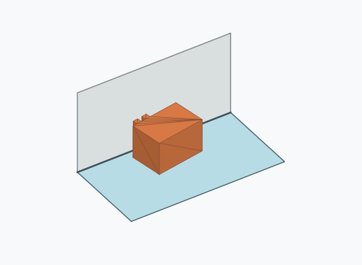 | Qk4a_0021 | 639 | 6.39% | 1.0000 |
| Qk4a_0019 |  | Qk4a_0019 | 629 | 6.29% | 1.0000 |
| Qk4a_0004 | 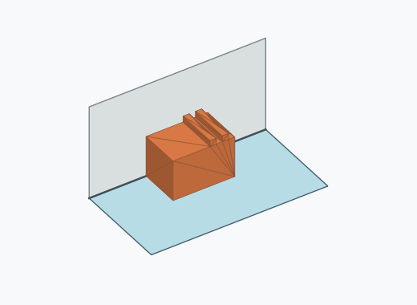 | Qk4a_0004 | 592 | 5.92% | 1.0000 |
| Qk4a_0014 | 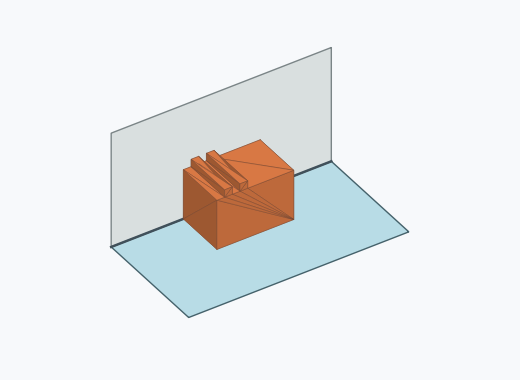 | Qk4a_0014 | 579 | 5.79% | 1.0000 |
| Qk4a_0010 | 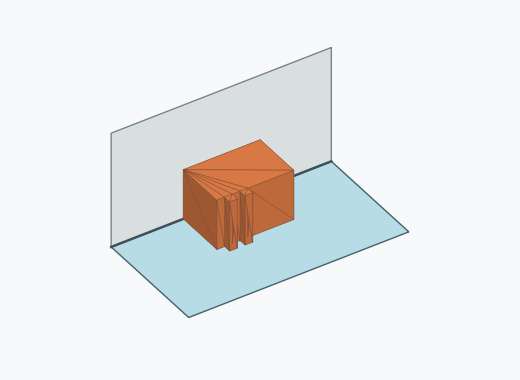 | Qk4a_0010 | 571 | 5.71% | 1.0000 |
| Qk4a_0006 | 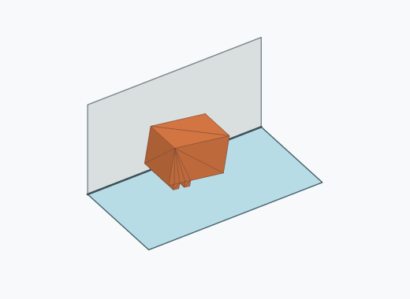 | Qk4a_0006 | 570 | 5.70% | 1.0000 |
| Qk4a_0024 |  | Qk4a_0024 | 568 | 5.68% | 1.0000 |
| Qk4a_0007 |  | Qk4a_0007, Qk4a_0008 | 525 | 5.25% | 1.0000 |
| Qk4a_0001 | 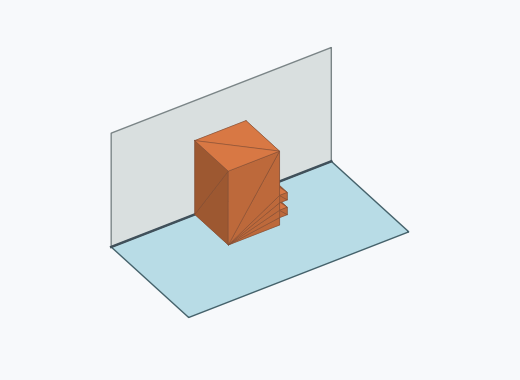 | Qk4a_0001 | 403 | 4.03% | 1.0000 |
| Qk4a_0017 | 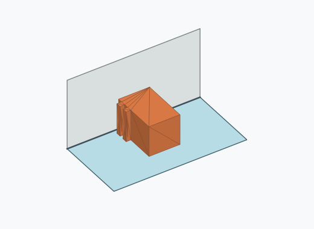 | Qk4a_0017 | 382 | 3.82% | 1.0000 |
| Qk4a_0016 | 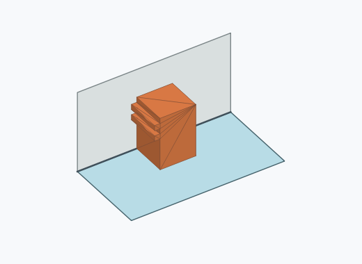 | Qk4a_0016 | 365 | 3.65% | 1.0000 |
| Qk4a_0002 |  | Qk4a_0002 | 363 | 3.63% | 1.0000 |
| Qk4a_0018 |  | Qk4a_0018 | 359 | 3.59% | 1.0000 |
| Qk4a_0020 | 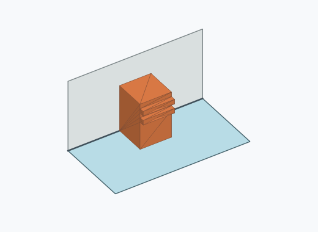 | Qk4a_0020 | 358 | 3.58% | 1.0000 |
| Qk4a_0003 |  | Qk4a_0003 | 352 | 3.52% | 1.0000 |
| Qk4a_0013 | 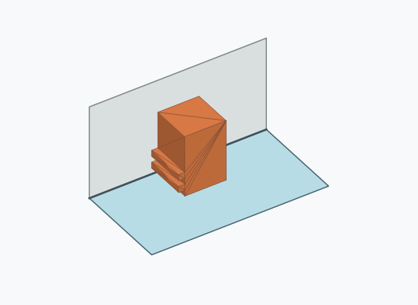 | Qk4a_0013 | 348 | 3.48% | 1.0000 |
| Qk4a_0025 |  | Qk4a_0025 | 344 | 3.44% | 1.0000 |
| Qk4a_0022 | 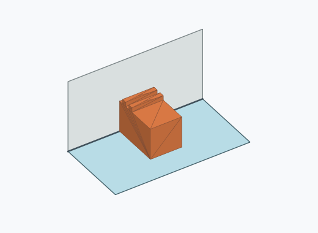 | Qk4a_0022 | 340 | 3.40% | 1.0000 |
| Qk4a_0015 |  | Qk4a_0015 | 324 | 3.24% | 1.0000 |
| Qk4a_0009 | 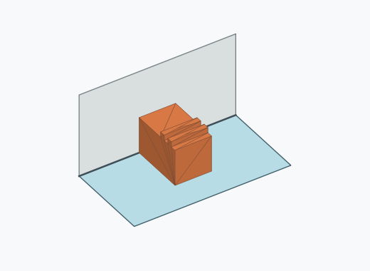 | Qk4a_0009 | 308 | 3.08% | 1.0000 |
| Qk4a_0005 |  | Qk4a_0005 | 285 | 2.85% | 1.0000 |
| Qk4a_0023 | 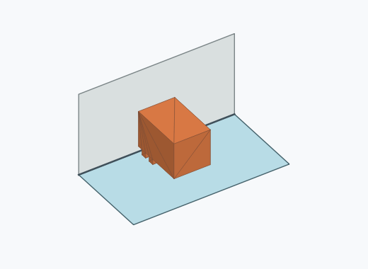 | Qk4a_0023 | 282 | 2.82% | 1.0000 |
| Qk4a_0011 |  | Qk4a_0011 | 256 | 2.56% | 1.0000 |
| Qk4a_0012 | 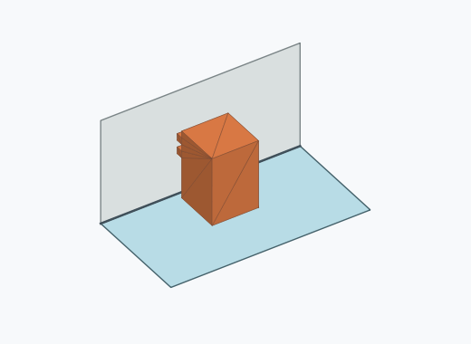 | Qk4a_0012 | 253 | 2.53% | 1.0000 |

[All original observations and member images](original_observations.json), [memberships](membership.csv), [barrier evidence](grouping_geometry.json), [member stability curves](group_stability.csv), [individual disturbance curves](stability.csv), [validation](validation.json).

Frequencies retain the original completed-drop denominator. Stability scores describe the configured virtual chute.
