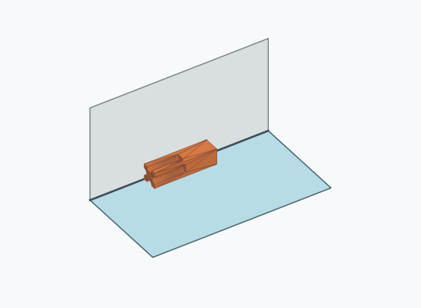
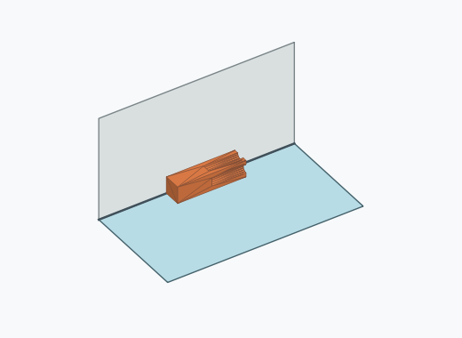
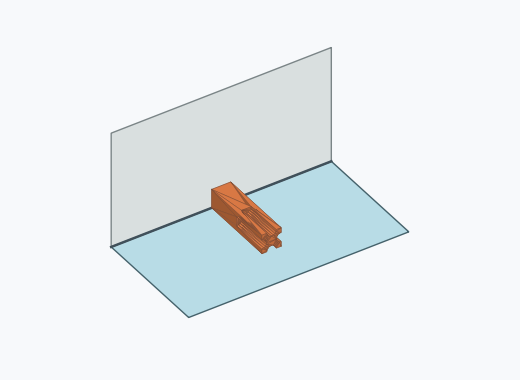
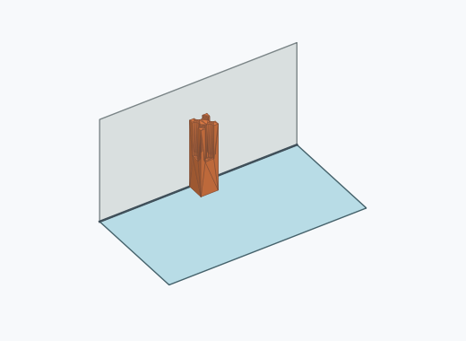
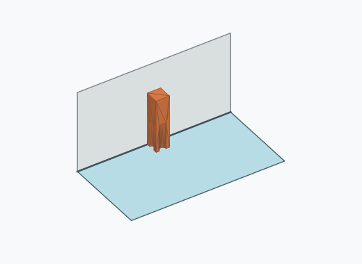

# Ql1i

[Workpiece index](../README.md#workpieces)

## 10,000-drop paper study

The stationary series recorded **9,995** settled outcomes. The moving series recorded **9,992** settled outcomes at the virtual exit. Each series contains 10,000 drops.

[Study overview](simulations/20261107_10000/README.md) · [Stationary results](simulations/20261107_10000/static/README.md) · [Moving results](simulations/20261107_10000/100mm_s/README.md)

## Historical pose catalogue

Group numbers rank the saved pose basins by their combined incidence within each observation phase. Pose 0 is the most frequent individual pose in its observation phase. The membership CSV links the displayed numbers to the saved pose IDs. Groups below 1% remain visible.

[Group membership CSV](group_memberships.csv) · [Grouping method](../README.md#catalogue-grouping)

### Transport poses

9,985 settled outcomes across 10,000 historical drops on a 500 mm chute. Incidence uses all completed drops as the denominator.

Outcome counts: settled: 9,985, unsettled: 15.

| Pose | Group | Image | Count | Incidence | 95% interval | Share of settled outcomes |
| --- | --- | --- | ---: | ---: | ---: | ---: |
| Pose 0 | Group 0 |  | 4544 | 45.44 % | 44.47–46.42 % | 45.51 % |
| Pose 1 | Group 1 |  | 4376 | 43.76 % | 42.79–44.73 % | 43.83 % |
| Pose 2 | Group 2 |  | 532 | 5.32 % | 4.90–5.78 % | 5.33 % |
| Pose 3 | Group 3 |  | 266 | 2.66 % | 2.36–2.99 % | 2.66 % |
| Pose 4 | Group 4 |  | 228 | 2.28 % | 2.01–2.59 % | 2.28 % |
| Pose 5 | Group 5 |  | 39 | 0.39 % | 0.29–0.53 % | 0.39 % |

[Pose catalogue JSON](poses.json) · [Pose catalogue YAML](poses.yaml) · [Frequencies](frequencies.csv) · [Trial records](trials.csv)

Pose orientations use `xyzw` quaternions from the workpiece frame to the chute frame. Recognition uses the recorded symmetry, a 5° tolerance, and a 1° ambiguity margin. The pose registry reserves previously observed IDs for later recognition.

### Historical run files

- [Configuration](config.json)
- [Manifest](manifest.json)
- [Earlier 1,000-drop comparisons](simulations/README.md)
