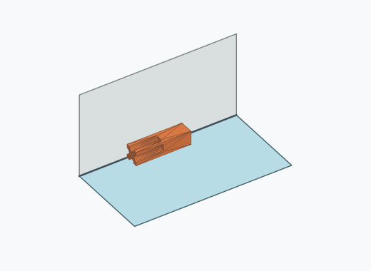
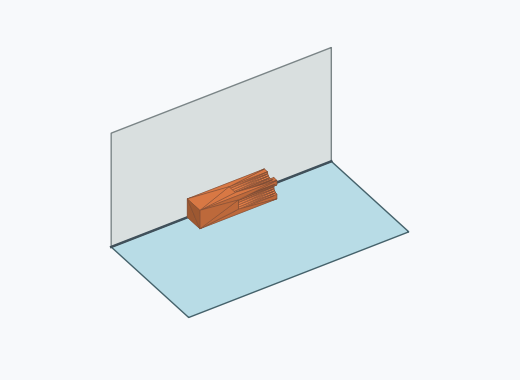
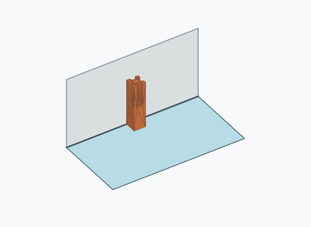
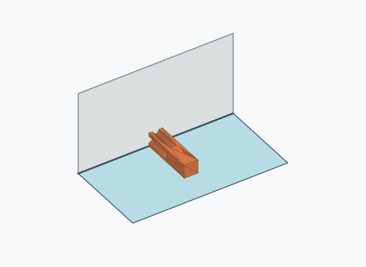

# Ql1i: grouped observed poses

10,000 completed drops; 9,985 settled. 6 assessed source poses; 5 groups meet the 1% cutoff.

Grouping uses 0.5 mm equivalent lift and a 60° maximum diameter. All members receive the same disturbance protocol.

| Representative | Image | Members | Combined count | Frequency | Retention AUC |
| --- | --- | --- | ---: | ---: | ---: |
| Ql1i_0002 |  | Ql1i_0002 | 4544 | 45.44% | 1.0000 |
| Ql1i_0003 |  | Ql1i_0003 | 4376 | 43.76% | 1.0000 |
| Ql1i_0004 |  | Ql1i_0004 | 532 | 5.32% | 0.9922 |
| Ql1i_0005 |  | Ql1i_0005 | 266 | 2.66% | 0.9010 |
| Ql1i_0006 |  | Ql1i_0006 | 228 | 2.28% | 0.8958 |

[All original observations and member images](original_observations.json), [memberships](membership.csv), [barrier evidence](grouping_geometry.json), [member stability curves](group_stability.csv), [individual disturbance curves](stability.csv), [validation](validation.json).

Frequencies retain the original completed-drop denominator. Stability scores describe the configured virtual chute.
