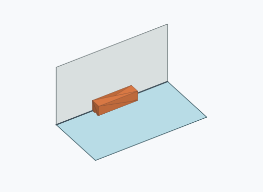
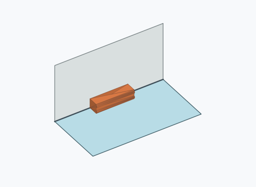
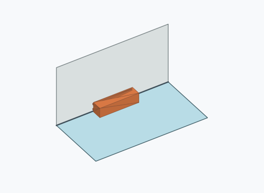
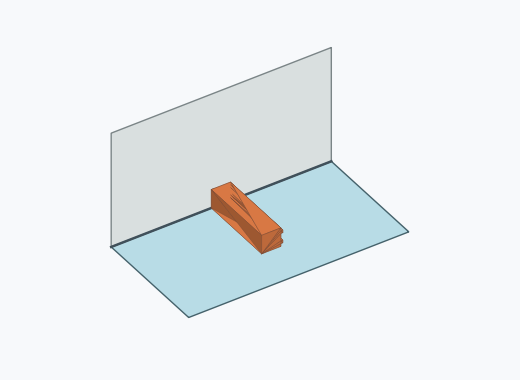
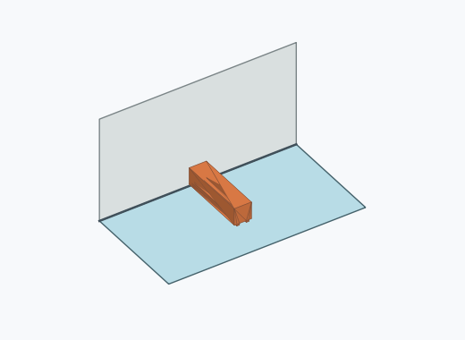

# Ql2a: grouped observed poses

10,000 completed drops; 9,942 settled. 19 assessed source poses; 8 groups meet the 1% cutoff.

Grouping uses 0.5 mm equivalent lift and a 60° maximum diameter. All members receive the same disturbance protocol.

| Representative | Image | Members | Combined count | Frequency | Retention AUC |
| --- | --- | --- | ---: | ---: | ---: |
| Ql2a_0002 |  | Ql2a_0002 | 2355 | 23.55% | 1.0000 |
| Ql2a_0008 |  | Ql2a_0008 | 2260 | 22.60% | 1.0000 |
| Ql2a_0007 |  | Ql2a_0007 | 2191 | 21.91% | 1.0000 |
| Ql2a_0003 |  | Ql2a_0003 | 2176 | 21.76% | 1.0000 |
| Ql2a_0021 |  | Ql2a_0020, Ql2a_0021 | 175 | 1.75% | 0.9714 |
| Ql2a_0015 |  | Ql2a_0015 | 171 | 1.71% | 1.0000 |
| Ql2a_0009 |  | Ql2a_0009 | 165 | 1.65% | 0.9688 |
| Ql2a_0010 |  | Ql2a_0010 | 158 | 1.58% | 0.9687 |

[All original observations and member images](original_observations.json), [memberships](membership.csv), [barrier evidence](grouping_geometry.json), [member stability curves](group_stability.csv), [individual disturbance curves](stability.csv), [validation](validation.json).

Frequencies retain the original completed-drop denominator. Stability scores describe the configured virtual chute.
