# Ql2a

[Workpiece index](../README.md#workpieces)

## Historical pose catalogue

Group numbers rank the saved pose basins by their combined incidence within each observation phase. Pose 0 is the most frequent individual pose in its observation phase. The membership CSV links the displayed numbers to the saved pose IDs. Groups below 1% remain visible.

[Group membership CSV](group_memberships.csv) · [Grouping method](../README.md#catalogue-grouping)

### Transport poses

9,942 settled outcomes across 10,000 historical drops on a 500 mm chute. Incidence uses all completed drops as the denominator.

Outcome counts: settled: 9,942, unsettled: 58.

| Pose | Group | Image | Count | Incidence | 95% interval | Share of settled outcomes |
| --- | --- | --- | ---: | ---: | ---: | ---: |
| Pose 0 | Group 0 | 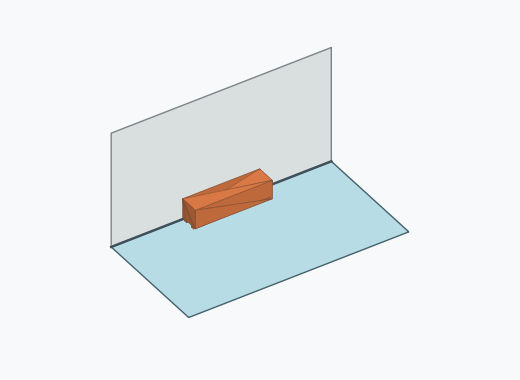 | 2355 | 23.55 % | 22.73–24.39 % | 23.69 % |
| Pose 1 | Group 1 | 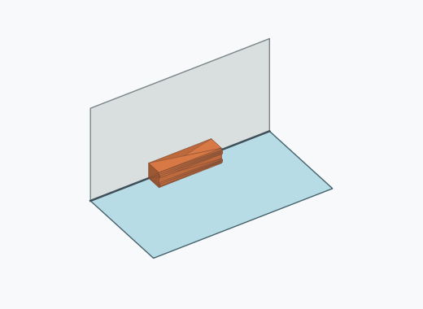 | 2260 | 22.60 % | 21.79–23.43 % | 22.73 % |
| Pose 2 | Group 2 | 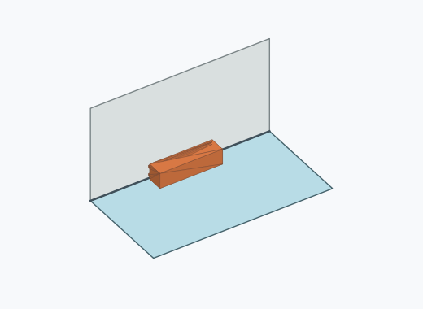 | 2191 | 21.91 % | 21.11–22.73 % | 22.04 % |
| Pose 3 | Group 3 |  | 2176 | 21.76 % | 20.96–22.58 % | 21.89 % |
| Pose 4 | Group 5 |  | 171 | 1.71 % | 1.47–1.98 % | 1.72 % |
| Pose 5 | Group 4 | 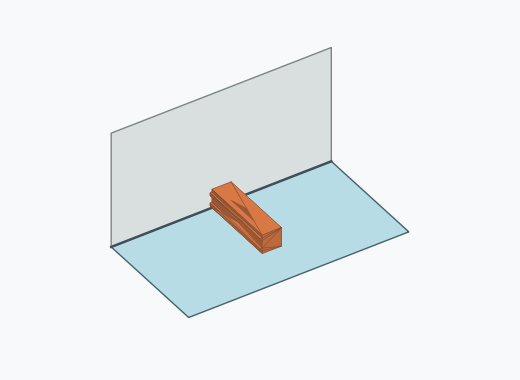 | 169 | 1.69 % | 1.46–1.96 % | 1.70 % |
| Pose 6 | Group 6 | 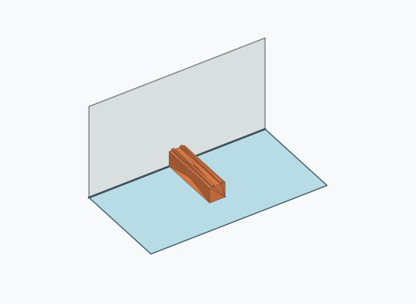 | 165 | 1.65 % | 1.42–1.92 % | 1.66 % |
| Pose 7 | Group 7 |  | 158 | 1.58 % | 1.35–1.84 % | 1.59 % |
| Pose 8 | Group 8 | 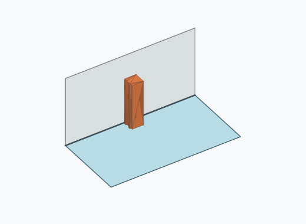 | 89 | 0.89 % | 0.72–1.09 % | 0.90 % |
| Pose 9 | Group 9 | 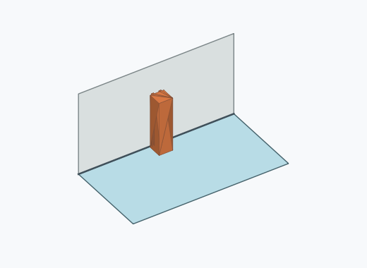 | 70 | 0.70 % | 0.55–0.88 % | 0.70 % |
| Pose 10 | Group 10 |  | 57 | 0.57 % | 0.44–0.74 % | 0.57 % |
| Pose 11 | Group 11 | 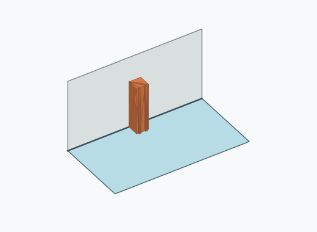 | 41 | 0.41 % | 0.30–0.56 % | 0.41 % |
| Pose 12 | Group 12 |  | 14 | 0.14 % | 0.08–0.23 % | 0.14 % |
| Pose 13 | Group 13 | 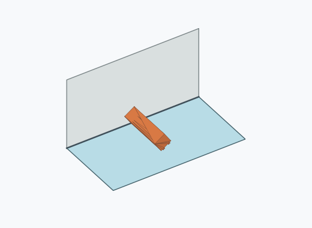 | 12 | 0.12 % | 0.07–0.21 % | 0.12 % |
| Pose 14 | Group 4 |  | 6 | 0.06 % | 0.03–0.13 % | 0.06 % |
| Pose 15 | Group 14 | 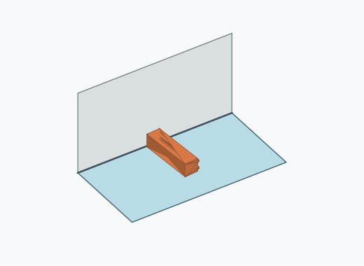 | 5 | 0.05 % | 0.02–0.12 % | 0.05 % |
| Pose 16 | Group 15 | 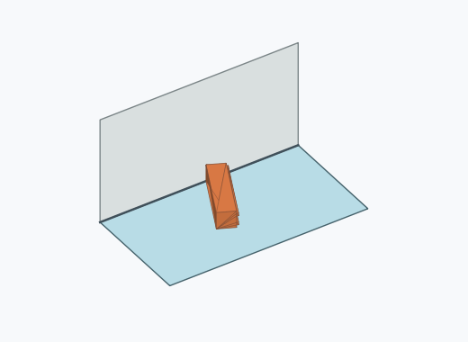 | 1 | 0.01 % | 0.00–0.06 % | 0.01 % |
| Pose 17 | Group 16 |  | 1 | 0.01 % | 0.00–0.06 % | 0.01 % |
| Pose 18 | Group 17 |  | 1 | 0.01 % | 0.00–0.06 % | 0.01 % |

[Pose catalogue JSON](poses.json) · [Pose catalogue YAML](poses.yaml) · [Frequencies](frequencies.csv) · [Trial records](trials.csv)

Pose orientations use `xyzw` quaternions from the workpiece frame to the chute frame. Recognition uses the recorded symmetry, a 5° tolerance, and a 1° ambiguity margin. The pose registry reserves previously observed IDs for later recognition.

### Historical run files

- [Configuration](config.json)
- [Manifest](manifest.json)
