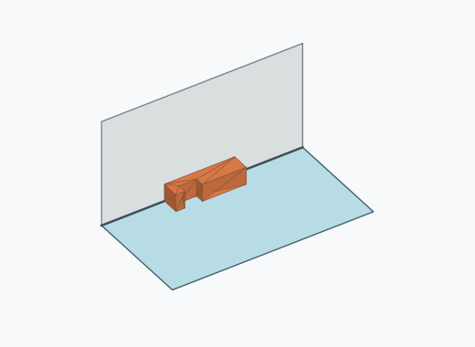
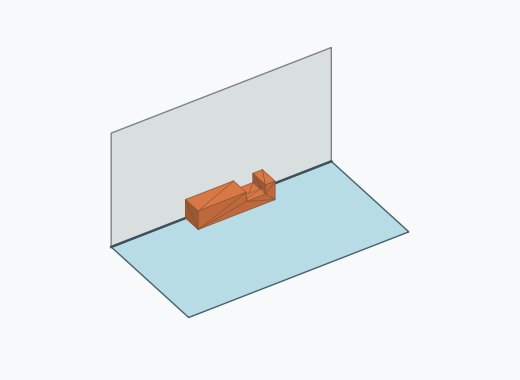
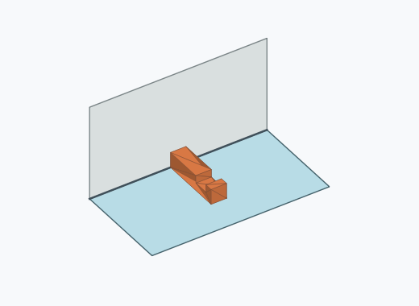
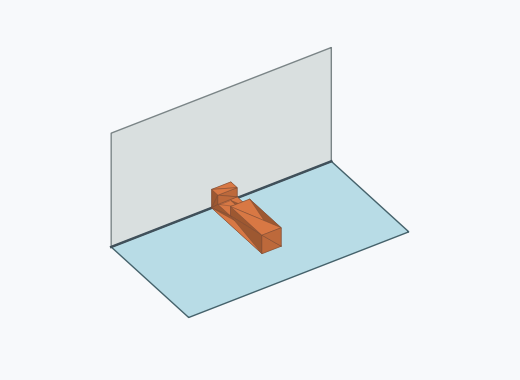
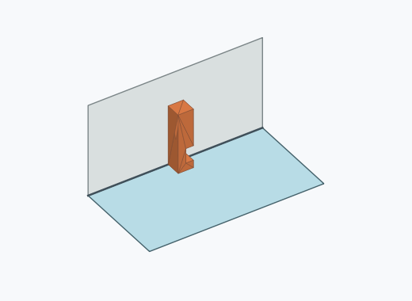

# Ql4i

[Workpiece index](../README.md#workpieces)

## Historical pose catalogue

Group numbers rank the saved pose basins by their combined incidence within each observation phase. Pose 0 is the most frequent individual pose in its observation phase. The membership CSV links the displayed numbers to the saved pose IDs. Groups below 1% remain visible.

[Group membership CSV](group_memberships.csv) · [Grouping method](../README.md#catalogue-grouping)

### Transport poses

9,979 settled outcomes across 10,000 historical drops on a 500 mm chute. Incidence uses all completed drops as the denominator.

Outcome counts: settled: 9,979, unsettled: 21.

| Pose | Group | Image | Count | Incidence | 95% interval | Share of settled outcomes |
| --- | --- | --- | ---: | ---: | ---: | ---: |
| Pose 0 | Group 0 |  | 1266 | 12.66 % | 12.02–13.33 % | 12.69 % |
| Pose 1 | Group 1 |  | 1208 | 12.08 % | 11.46–12.73 % | 12.11 % |
| Pose 2 | Group 2 |  | 1190 | 11.90 % | 11.28–12.55 % | 11.93 % |
| Pose 3 | Group 3 |  | 1178 | 11.78 % | 11.16–12.43 % | 11.80 % |
| Pose 4 | Group 4 |  | 1110 | 11.10 % | 10.50–11.73 % | 11.12 % |
| Pose 5 | Group 5 |  | 1042 | 10.42 % | 9.84–11.03 % | 10.44 % |
| Pose 6 | Group 6 |  | 1040 | 10.40 % | 9.82–11.01 % | 10.42 % |
| Pose 7 | Group 7 |  | 1001 | 10.01 % | 9.44–10.61 % | 10.03 % |
| Pose 8 | Group 8 |  | 124 | 1.24 % | 1.04–1.48 % | 1.24 % |
| Pose 9 | Group 9 |  | 122 | 1.22 % | 1.02–1.45 % | 1.22 % |
| Pose 10 | Group 10 |  | 114 | 1.14 % | 0.95–1.37 % | 1.14 % |
| Pose 11 | Group 11 |  | 110 | 1.10 % | 0.91–1.32 % | 1.10 % |
| Pose 12 | Group 12 |  | 70 | 0.70 % | 0.55–0.88 % | 0.70 % |
| Pose 13 | Group 13 |  | 66 | 0.66 % | 0.52–0.84 % | 0.66 % |
| Pose 14 | Group 14 |  | 62 | 0.62 % | 0.48–0.79 % | 0.62 % |
| Pose 15 | Group 15 |  | 61 | 0.61 % | 0.48–0.78 % | 0.61 % |
| Pose 16 | Group 16 |  | 50 | 0.50 % | 0.38–0.66 % | 0.50 % |
| Pose 17 | Group 17 |  | 44 | 0.44 % | 0.33–0.59 % | 0.44 % |
| Pose 18 | Group 18 |  | 33 | 0.33 % | 0.24–0.46 % | 0.33 % |
| Pose 19 | Group 19 |  | 27 | 0.27 % | 0.19–0.39 % | 0.27 % |
| Pose 20 | Group 20 |  | 20 | 0.20 % | 0.13–0.31 % | 0.20 % |
| Pose 21 | Group 21 |  | 18 | 0.18 % | 0.11–0.28 % | 0.18 % |
| Pose 22 | Group 22 |  | 14 | 0.14 % | 0.08–0.23 % | 0.14 % |
| Pose 23 | Group 23 |  | 9 | 0.09 % | 0.05–0.17 % | 0.09 % |

[Pose catalogue JSON](poses.json) · [Pose catalogue YAML](poses.yaml) · [Frequencies](frequencies.csv) · [Trial records](trials.csv)

Pose orientations use `xyzw` quaternions from the workpiece frame to the chute frame. Recognition uses the recorded symmetry, a 5° tolerance, and a 1° ambiguity margin. The pose registry reserves previously observed IDs for later recognition.

### Historical run files

- [Configuration](config.json)
- [Manifest](manifest.json)

<!-- remaining-workpieces-20261110_10000:start -->
## Additional 10,000-drop runs

10,000 stationary and 10,000 moving-belt drops with the archived reference settings.

[Results and validation](simulations/20261110_10000/README.md).
<!-- remaining-workpieces-20261110_10000:end -->
