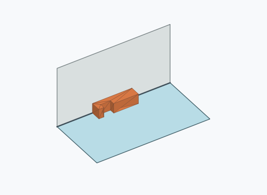
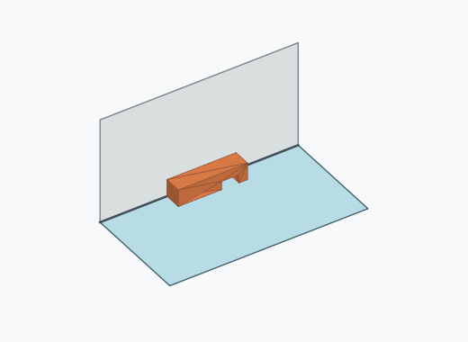
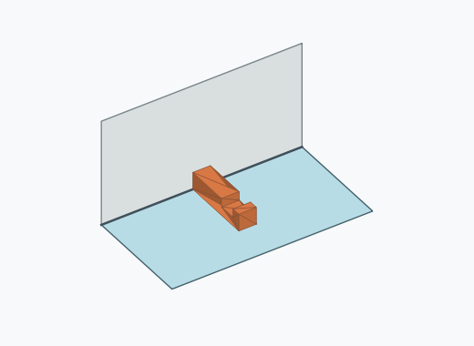
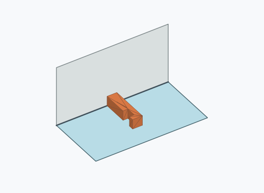

# Ql4i: grouped observed poses

10,000 completed drops; 9,979 settled. 24 assessed source poses; 12 groups meet the 1% cutoff.

Grouping uses 0.5 mm equivalent lift and a 60° maximum diameter. All members receive the same disturbance protocol.

| Representative | Image | Members | Combined count | Frequency | Retention AUC |
| --- | --- | --- | ---: | ---: | ---: |
| Ql4i_0012 |  | Ql4i_0012 | 1266 | 12.66% | 1.0000 |
| Ql4i_0019 |  | Ql4i_0019 | 1208 | 12.08% | 1.0000 |
| Ql4i_0018 |  | Ql4i_0018 | 1190 | 11.90% | 1.0000 |
| Ql4i_0013 |  | Ql4i_0013 | 1178 | 11.78% | 1.0000 |
| Ql4i_0003 |  | Ql4i_0003 | 1110 | 11.10% | 1.0000 |
| Ql4i_0008 |  | Ql4i_0008 | 1042 | 10.42% | 1.0000 |
| Ql4i_0002 |  | Ql4i_0002 | 1040 | 10.40% | 1.0000 |
| Ql4i_0006 |  | Ql4i_0006 | 1001 | 10.01% | 1.0000 |
| Ql4i_0022 |  | Ql4i_0022 | 124 | 1.24% | 1.0000 |
| Ql4i_0017 |  | Ql4i_0017 | 122 | 1.22% | 0.8281 |
| Ql4i_0011 |  | Ql4i_0011 | 114 | 1.14% | 1.0000 |
| Ql4i_0020 |  | Ql4i_0020 | 110 | 1.10% | 1.0000 |

[All original observations and member images](original_observations.json), [memberships](membership.csv), [barrier evidence](grouping_geometry.json), [member stability curves](group_stability.csv), [individual disturbance curves](stability.csv), [validation](validation.json).

Frequencies retain the original completed-drop denominator. Stability scores describe the configured virtual chute.
