# Rf1a

[Workpiece index](../README.md#workpieces)

## 10,000-drop paper study

The stationary series recorded **9,988** settled outcomes. The moving series recorded **10,000** settled outcomes at the virtual exit. Each series contains 10,000 drops.

[Study overview](simulations/20261107_10000/README.md) · [Stationary results](simulations/20261107_10000/static/README.md) · [Moving results](simulations/20261107_10000/100mm_s/README.md)

## Historical pose catalogue

Group numbers rank the saved pose basins by their combined incidence within each observation phase. Pose 0 is the most frequent individual pose in its observation phase. The membership CSV links the displayed numbers to the saved pose IDs. Groups below 1% remain visible.

[Group membership CSV](group_memberships.csv) · [Grouping method](../README.md#catalogue-grouping)

### Transport poses

9,963 settled outcomes across 10,000 historical drops on a 500 mm chute. Incidence uses all completed drops as the denominator.

Outcome counts: settled: 9,963, unsettled: 37.

| Pose | Group | Image | Count | Incidence | 95% interval | Share of settled outcomes |
| --- | --- | --- | ---: | ---: | ---: | ---: |
| Pose 0 | Group 0 | 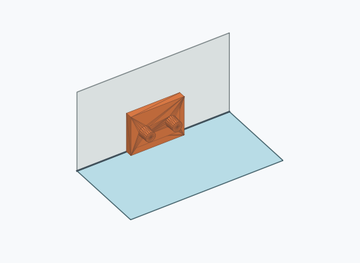 | 1529 | 15.29 % | 14.60–16.01 % | 15.35 % |
| Pose 1 | Group 1 | 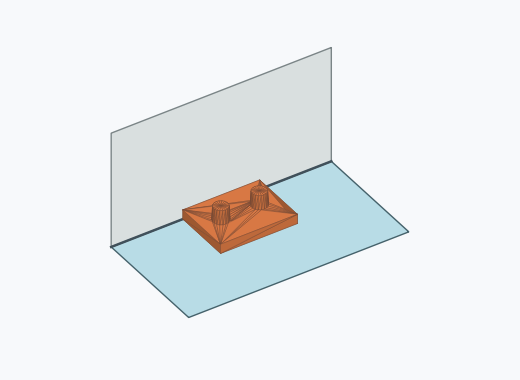 | 1409 | 14.09 % | 13.42–14.79 % | 14.14 % |
| Pose 2 | Group 2 | 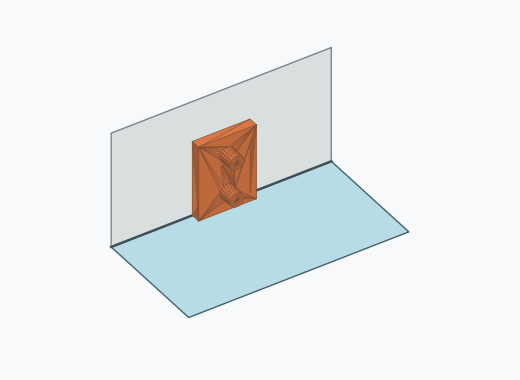 | 1033 | 10.33 % | 9.75–10.94 % | 10.37 % |
| Pose 3 | Group 3 | 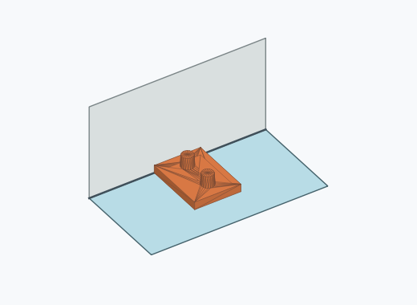 | 984 | 9.84 % | 9.27–10.44 % | 9.88 % |
| Pose 4 | Group 4 | 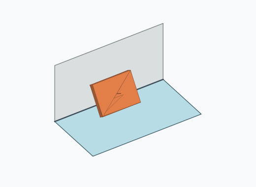 | 852 | 8.52 % | 7.99–9.08 % | 8.55 % |
| Pose 5 | Group 6 | 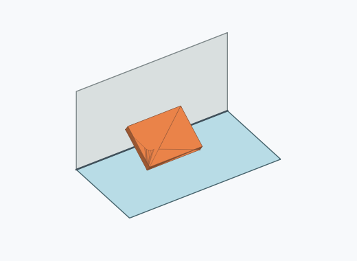 | 610 | 6.10 % | 5.65–6.59 % | 6.12 % |
| Pose 6 | Group 7 | 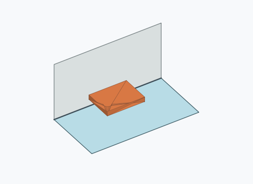 | 601 | 6.01 % | 5.56–6.49 % | 6.03 % |
| Pose 7 | Group 8 | 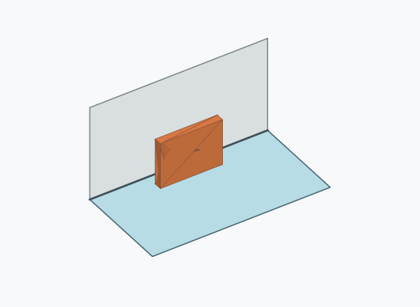 | 536 | 5.36 % | 4.94–5.82 % | 5.38 % |
| Pose 8 | Group 5 | 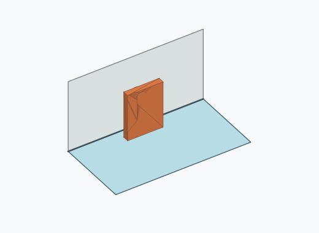 | 418 | 4.18 % | 3.81–4.59 % | 4.20 % |
| Pose 9 | Group 9 | 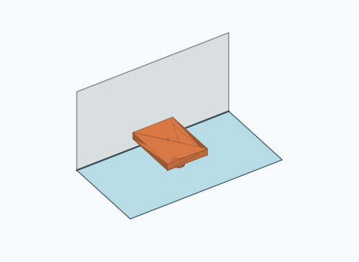 | 380 | 3.80 % | 3.44–4.19 % | 3.81 % |
| Pose 10 | Group 10 |  | 365 | 3.65 % | 3.30–4.04 % | 3.66 % |
| Pose 11 | Group 5 | 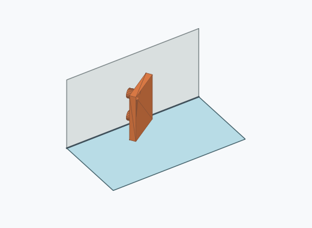 | 362 | 3.62 % | 3.27–4.00 % | 3.63 % |
| Pose 12 | Group 12 | 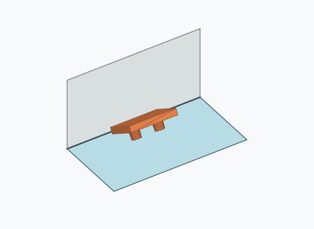 | 212 | 2.12 % | 1.86–2.42 % | 2.13 % |
| Pose 13 | Group 13 | 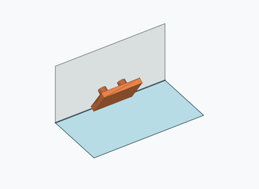 | 192 | 1.92 % | 1.67–2.21 % | 1.93 % |
| Pose 14 | Group 14 | 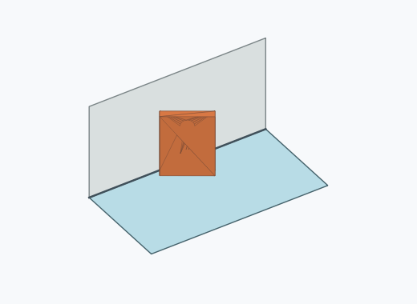 | 168 | 1.68 % | 1.45–1.95 % | 1.69 % |
| Pose 15 | Group 11 | 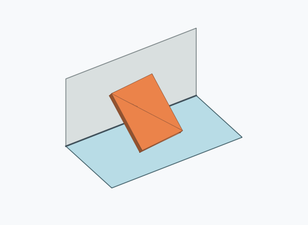 | 144 | 1.44 % | 1.22–1.69 % | 1.45 % |
| Pose 16 | Group 9 | 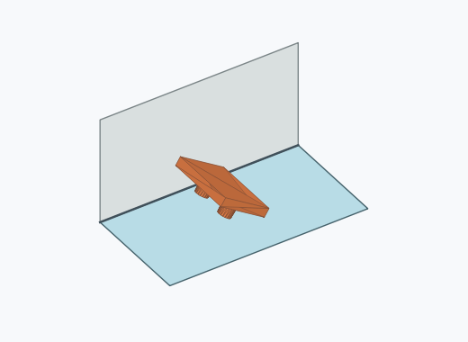 | 78 | 0.78 % | 0.63–0.97 % | 0.78 % |
| Pose 17 | Group 11 | 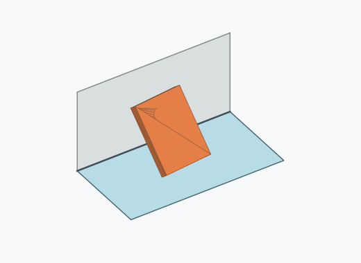 | 75 | 0.75 % | 0.60–0.94 % | 0.75 % |
| Pose 18 | Group 7 | 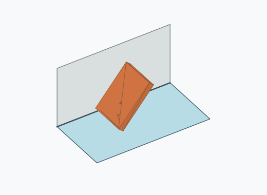 | 6 | 0.06 % | 0.03–0.13 % | 0.06 % |
| Pose 19 | Group 1 | 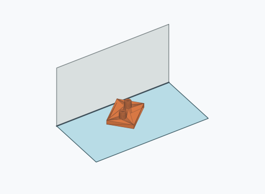 | 4 | 0.04 % | 0.02–0.10 % | 0.04 % |
| Pose 20 | Group 15 | 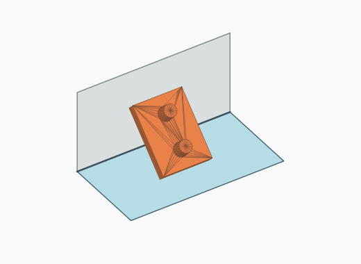 | 1 | 0.01 % | 0.00–0.06 % | 0.01 % |
| Pose 21 | Group 11 | 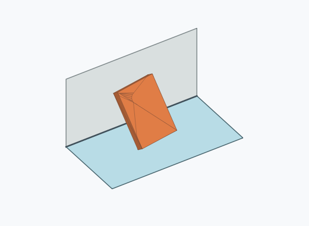 | 1 | 0.01 % | 0.00–0.06 % | 0.01 % |
| Pose 22 | Group 3 | 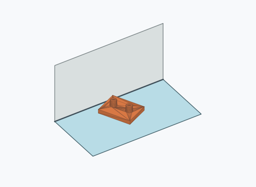 | 1 | 0.01 % | 0.00–0.06 % | 0.01 % |
| Pose 23 | Group 11 |  | 1 | 0.01 % | 0.00–0.06 % | 0.01 % |
| Pose 24 | Group 16 | 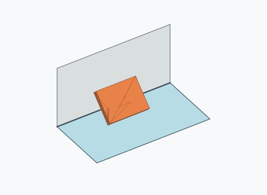 | 1 | 0.01 % | 0.00–0.06 % | 0.01 % |

[Pose catalogue JSON](poses.json) · [Pose catalogue YAML](poses.yaml) · [Frequencies](frequencies.csv) · [Trial records](trials.csv)

Pose orientations use `xyzw` quaternions from the workpiece frame to the chute frame. Recognition uses the recorded symmetry, a 5° tolerance, and a 1° ambiguity margin. The pose registry reserves previously observed IDs for later recognition.

### Historical run files

- [Configuration](config.json)
- [Manifest](manifest.json)
- [Earlier 1,000-drop comparisons](simulations/README.md)
