# Rf1a: grouped observed poses

10,000 completed drops; 9,963 settled. 25 assessed source poses; 15 groups meet the 1% cutoff.

Grouping uses 0.5 mm equivalent lift and a 60° maximum diameter. All members receive the same disturbance protocol.

| Representative | Image | Members | Combined count | Frequency | Retention AUC |
| --- | --- | --- | ---: | ---: | ---: |
| Rf1a_0007 | 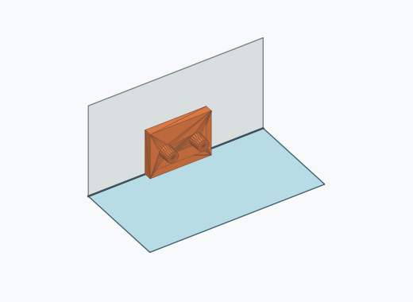 | Rf1a_0007 | 1529 | 15.29% | 1.0000 |
| Rf1a_0012 | 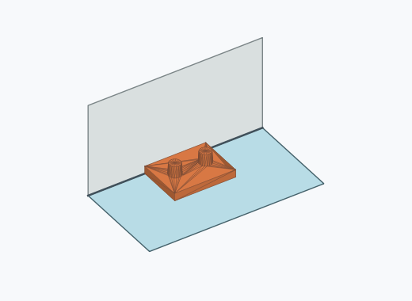 | Rf1a_0012, Rf1a_0022 | 1413 | 14.13% | 1.0000 |
| Rf1a_0005 | 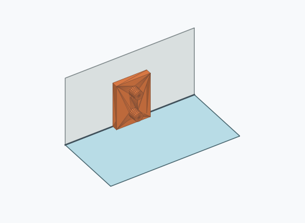 | Rf1a_0005 | 1033 | 10.33% | 1.0000 |
| Rf1a_0013 | 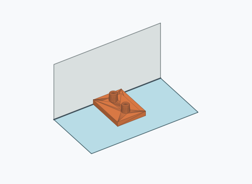 | Rf1a_0013, Rf1a_0023 | 985 | 9.85% | 1.0000 |
| Rf1a_0017 | 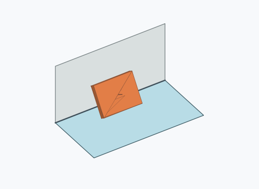 | Rf1a_0017 | 852 | 8.52% | 1.0000 |
| Rf1a_0011 | 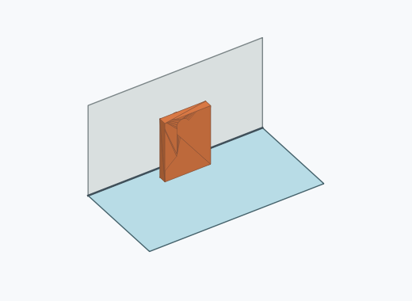 | Rf1a_0008, Rf1a_0011 | 780 | 7.80% | 1.0000 |
| Rf1a_0018 | 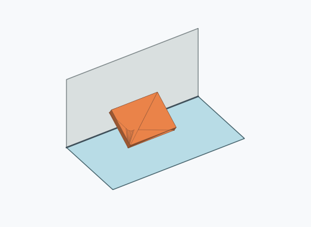 | Rf1a_0018 | 610 | 6.10% | 1.0000 |
| Rf1a_0004 | 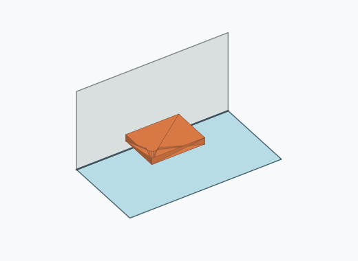 | Rf1a_0004, Rf1a_0019 | 607 | 6.07% | 1.0000 |
| Rf1a_0016 | 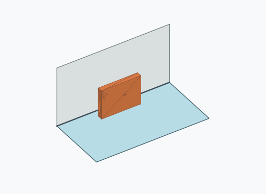 | Rf1a_0016 | 536 | 5.36% | 1.0000 |
| Rf1a_0001 | 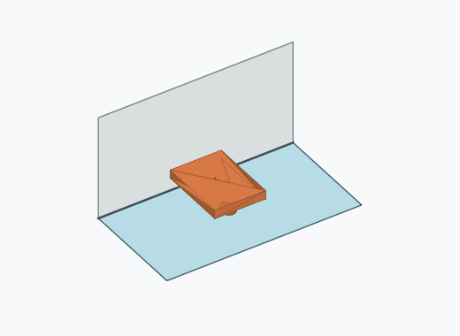 | Rf1a_0001, Rf1a_0002 | 458 | 4.58% | 1.0000 |
| Rf1a_0003 |  | Rf1a_0003 | 365 | 3.65% | 1.0000 |
| Rf1a_0014 | 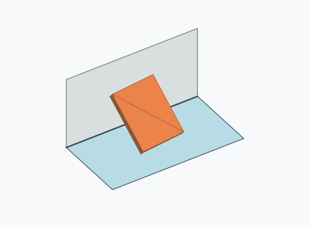 | Rf1a_0010, Rf1a_0014, Rf1a_0021, Rf1a_0024 | 221 | 2.21% | 1.0000 |
| Rf1a_0006 | 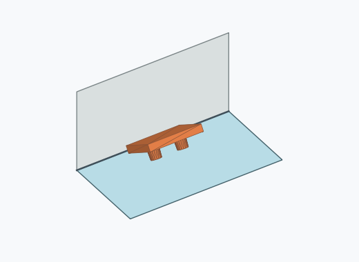 | Rf1a_0006 | 212 | 2.12% | 1.0000 |
| Rf1a_0015 | 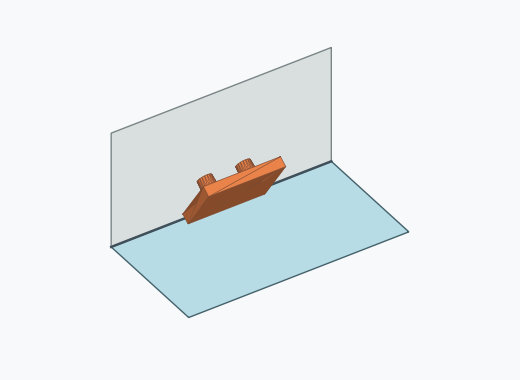 | Rf1a_0015 | 192 | 1.92% | 1.0000 |
| Rf1a_0009 | 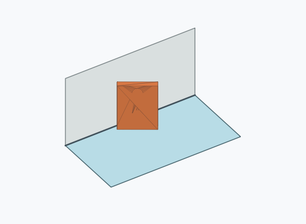 | Rf1a_0009 | 168 | 1.68% | 0.8958 |

[All original observations and member images](original_observations.json), [memberships](membership.csv), [barrier evidence](grouping_geometry.json), [member stability curves](group_stability.csv), [individual disturbance curves](stability.csv), [validation](validation.json).

Frequencies retain the original completed-drop denominator. Stability scores describe the configured virtual chute.
