# Rf2i

[Workpiece index](../README.md#workpieces)

## Historical pose catalogue

Group numbers rank the saved pose basins by their combined incidence within each observation phase. Pose 0 is the most frequent individual pose in its observation phase. The membership CSV links the displayed numbers to the saved pose IDs. Groups below 1% remain visible.

[Group membership CSV](group_memberships.csv) · [Grouping method](../README.md#catalogue-grouping)

### Transport poses

9,839 settled outcomes across 10,000 historical drops on a 500 mm chute. Incidence uses all completed drops as the denominator.

Outcome counts: settled: 9,839, unsettled: 161.

| Pose | Group | Image | Count | Incidence | 95% interval | Share of settled outcomes |
| --- | --- | --- | ---: | ---: | ---: | ---: |
| Pose 0 | Group 0 | 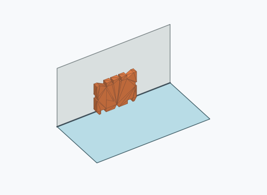 | 1592 | 15.92 % | 15.22–16.65 % | 16.18 % |
| Pose 1 | Group 1 | 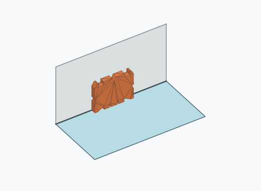 | 1554 | 15.54 % | 14.84–16.26 % | 15.79 % |
| Pose 2 | Group 2 | 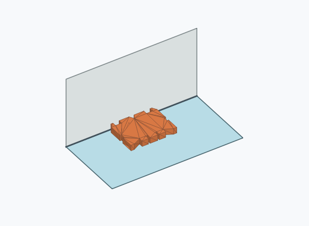 | 1515 | 15.15 % | 14.46–15.87 % | 15.40 % |
| Pose 3 | Group 3 | 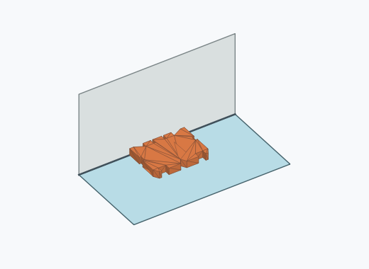 | 1391 | 13.91 % | 13.25–14.60 % | 14.14 % |
| Pose 4 | Group 4 |  | 1061 | 10.61 % | 10.02–11.23 % | 10.78 % |
| Pose 5 | Group 5 | 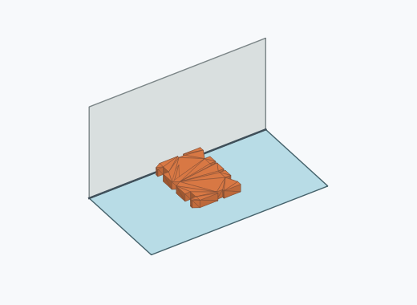 | 914 | 9.14 % | 8.59–9.72 % | 9.29 % |
| Pose 6 | Group 6 |  | 882 | 8.82 % | 8.28–9.39 % | 8.96 % |
| Pose 7 | Group 7 | 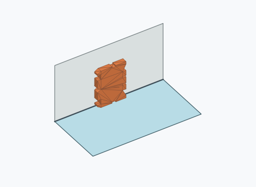 | 881 | 8.81 % | 8.27–9.38 % | 8.95 % |
| Pose 8 | Group 9 | 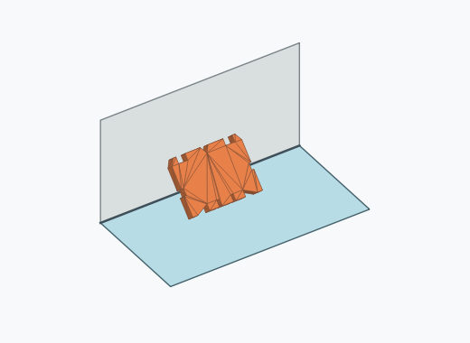 | 9 | 0.09 % | 0.05–0.17 % | 0.09 % |
| Pose 9 | Group 8 | 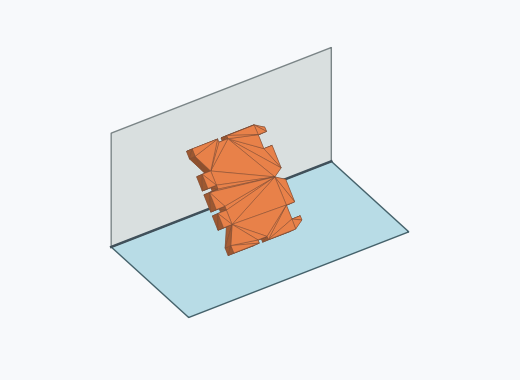 | 8 | 0.08 % | 0.04–0.16 % | 0.08 % |
| Pose 10 | Group 8 | 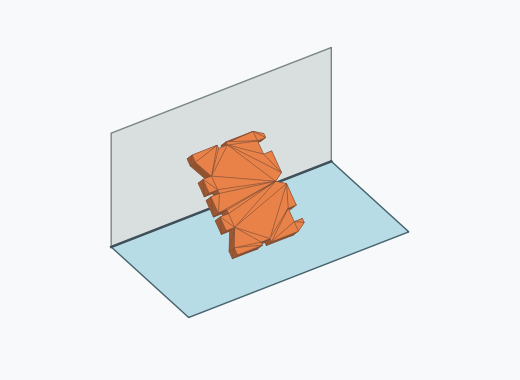 | 7 | 0.07 % | 0.03–0.14 % | 0.07 % |
| Pose 11 | Group 10 | 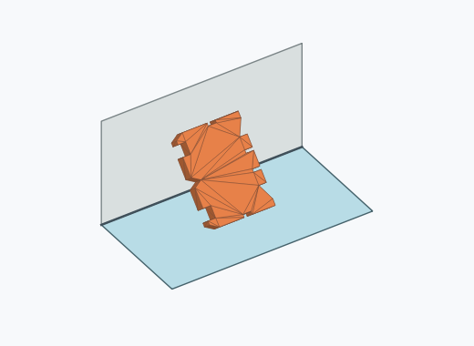 | 6 | 0.06 % | 0.03–0.13 % | 0.06 % |
| Pose 12 | Group 11 |  | 5 | 0.05 % | 0.02–0.12 % | 0.05 % |
| Pose 13 | Group 6 | 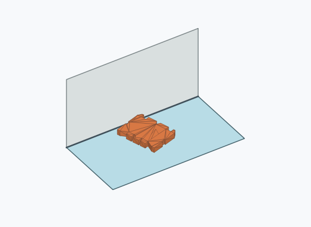 | 4 | 0.04 % | 0.02–0.10 % | 0.04 % |
| Pose 14 | Group 11 |  | 3 | 0.03 % | 0.01–0.09 % | 0.03 % |
| Pose 15 | Group 2 | 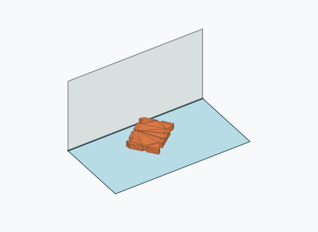 | 2 | 0.02 % | 0.01–0.07 % | 0.02 % |
| Pose 16 | Group 10 | 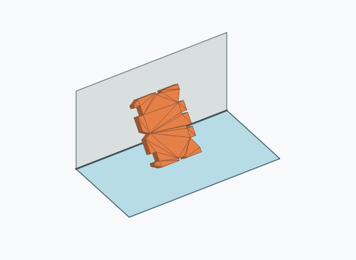 | 2 | 0.02 % | 0.01–0.07 % | 0.02 % |
| Pose 17 | Group 9 |  | 2 | 0.02 % | 0.01–0.07 % | 0.02 % |
| Pose 18 | Group 6 | 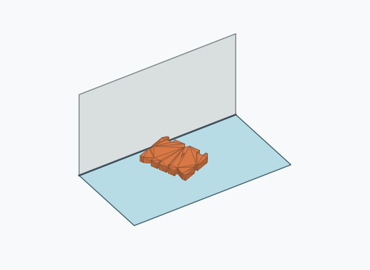 | 1 | 0.01 % | 0.00–0.06 % | 0.01 % |

[Pose catalogue JSON](poses.json) · [Pose catalogue YAML](poses.yaml) · [Frequencies](frequencies.csv) · [Trial records](trials.csv)

Pose orientations use `xyzw` quaternions from the workpiece frame to the chute frame. Recognition uses the recorded symmetry, a 5° tolerance, and a 1° ambiguity margin. The pose registry reserves previously observed IDs for later recognition.

### Historical run files

- [Configuration](config.json)
- [Manifest](manifest.json)

<!-- remaining-workpieces-20261110_10000:start -->
## Additional 10,000-drop runs

10,000 stationary and 10,000 moving-belt drops with the archived reference settings.

[Results and validation](simulations/20261110_10000/README.md).
<!-- remaining-workpieces-20261110_10000:end -->
