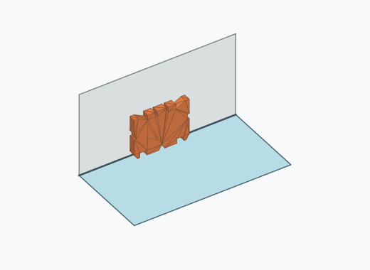
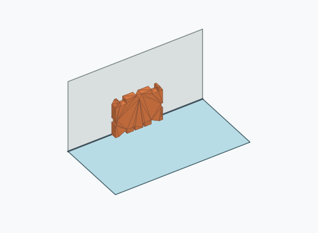
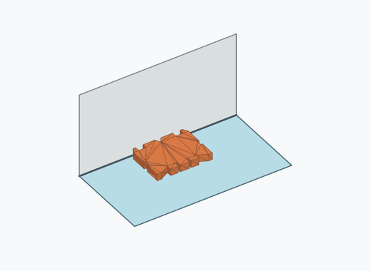
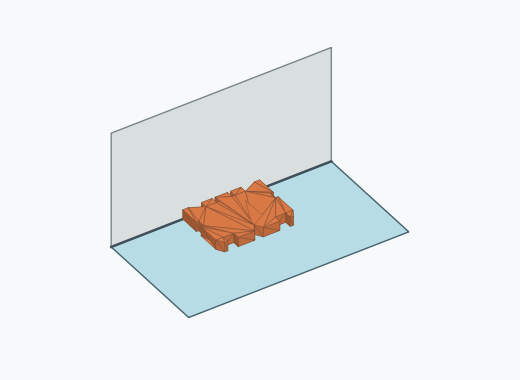
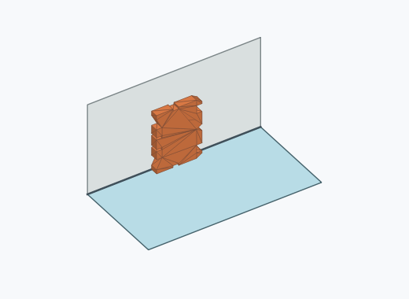
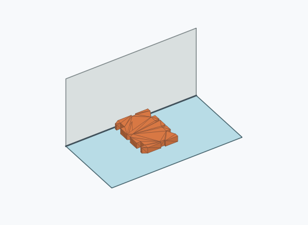

# Rf2i: grouped observed poses

10,000 completed drops; 9,839 settled. 19 assessed source poses; 8 groups meet the 1% cutoff.

Grouping uses 0.5 mm equivalent lift and a 60° maximum diameter. All members receive the same disturbance protocol.

| Representative | Image | Members | Combined count | Frequency | Retention AUC |
| --- | --- | --- | ---: | ---: | ---: |
| Rf2i_0006 |  | Rf2i_0006 | 1592 | 15.92% | 1.0000 |
| Rf2i_0005 |  | Rf2i_0005 | 1554 | 15.54% | 1.0000 |
| Rf2i_0003 |  | Rf2i_0003, Rf2i_0012 | 1517 | 15.17% | 1.0000 |
| Rf2i_0004 |  | Rf2i_0004 | 1391 | 13.91% | 1.0000 |
| Rf2i_0009 |  | Rf2i_0009 | 1061 | 10.61% | 1.0000 |
| Rf2i_0001 |  | Rf2i_0001 | 914 | 9.14% | 1.0000 |
| Rf2i_0010 |  | Rf2i_0010, Rf2i_0019, Rf2i_0020 | 887 | 8.87% | 1.0000 |
| Rf2i_0002 |  | Rf2i_0002 | 881 | 8.81% | 1.0000 |

[All original observations and member images](original_observations.json), [memberships](membership.csv), [barrier evidence](grouping_geometry.json), [member stability curves](group_stability.csv), [individual disturbance curves](stability.csv), [validation](validation.json).

Frequencies retain the original completed-drop denominator. Stability scores describe the configured virtual chute.
