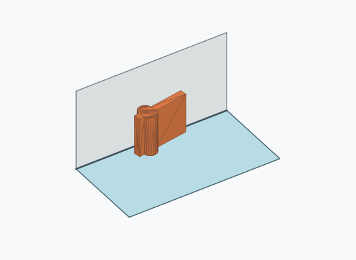
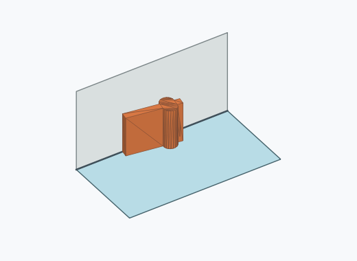
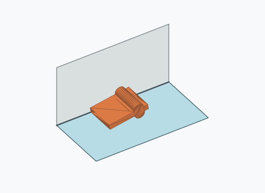
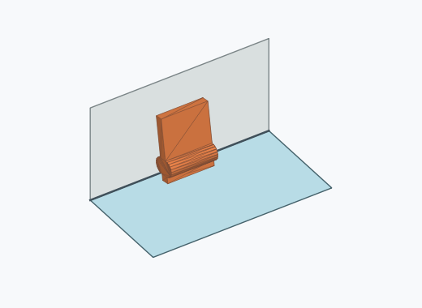
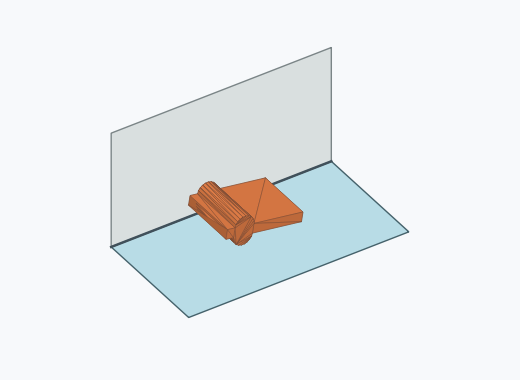
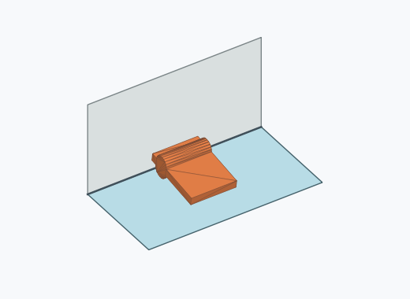
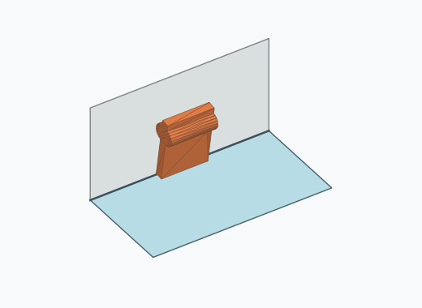
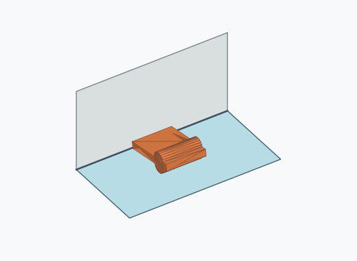
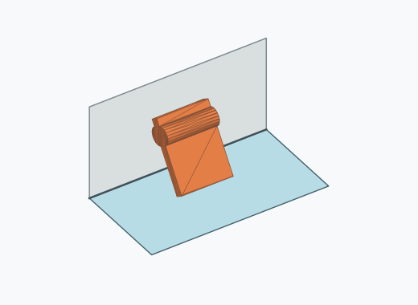

# Rf3a: grouped observed poses

10,000 completed drops; 9,965 settled. 19 assessed source poses; 9 groups meet the 1% cutoff.

Grouping uses 0.5 mm equivalent lift and a 60° maximum diameter. All members receive the same disturbance protocol.

| Representative | Image | Members | Combined count | Frequency | Retention AUC |
| --- | --- | --- | ---: | ---: | ---: |
| Rf3a_0001 |  | Rf3a_0001 | 1843 | 18.43% | 1.0000 |
| Rf3a_0009 |  | Rf3a_0009 | 1569 | 15.69% | 1.0000 |
| Rf3a_0012 |  | Rf3a_0012 | 1519 | 15.19% | 1.0000 |
| Rf3a_0003 |  | Rf3a_0003, Rf3a_0005 | 1459 | 14.59% | 1.0000 |
| Rf3a_0002 |  | Rf3a_0002 | 1372 | 13.72% | 1.0000 |
| Rf3a_0006 |  | Rf3a_0006, Rf3a_0008, Rf3a_0015 | 1198 | 11.98% | 1.0000 |
| Rf3a_0011 |  | Rf3a_0011 | 435 | 4.35% | 1.0000 |
| Rf3a_0007 |  | Rf3a_0007, Rf3a_0016, Rf3a_0017 | 429 | 4.29% | 1.0000 |
| Rf3a_0013 |  | Rf3a_0013, Rf3a_0014 | 122 | 1.22% | 1.0000 |

[All original observations and member images](original_observations.json), [memberships](membership.csv), [barrier evidence](grouping_geometry.json), [member stability curves](group_stability.csv), [individual disturbance curves](stability.csv), [validation](validation.json).

Frequencies retain the original completed-drop denominator. Stability scores describe the configured virtual chute.
