# Rf4i

[Workpiece index](../README.md#workpieces)

## Historical pose catalogue

Group numbers rank the saved pose basins by their combined incidence within each observation phase. The percentages in the table describe each individual pose. Groups below 1% remain visible.

[Group membership CSV](group_memberships.csv) · [Grouping method](../README.md#catalogue-grouping)

### Transport poses

9,885 settled outcomes across 10,000 historical drops on a 500 mm chute. Incidence uses all completed drops as the denominator.

Outcome counts: settled: 9,885, unsettled: 115.

| Pose | Group | Image | Count | Incidence | 95% interval | Share of settled outcomes |
| --- | --- | --- | ---: | ---: | ---: | ---: |
| Rf4i_0008 | Group 0 | 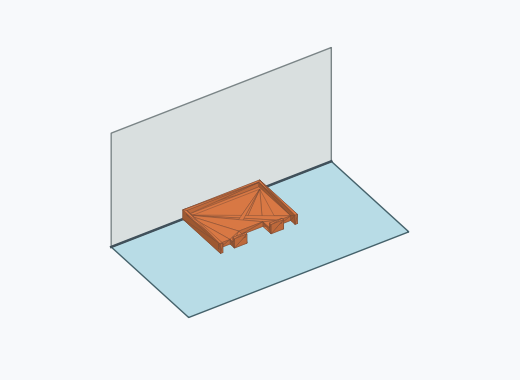 | 1061 | 10.61 % | 10.02–11.23 % | 10.73 % |
| Rf4i_0005 | Group 1 | 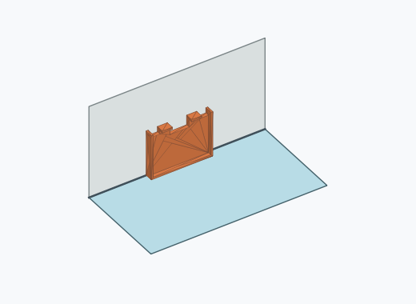 | 1052 | 10.52 % | 9.93–11.14 % | 10.64 % |
| Rf4i_0015 | Group 2 | 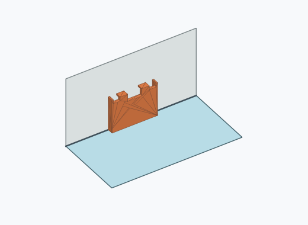 | 816 | 8.16 % | 7.64–8.71 % | 8.25 % |
| Rf4i_0003 | Group 3 | 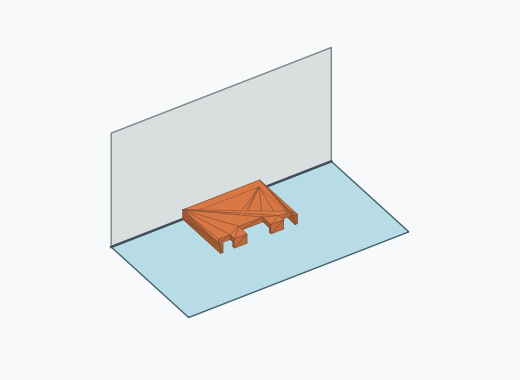 | 776 | 7.76 % | 7.25–8.30 % | 7.85 % |
| Rf4i_0006 | Group 4 | 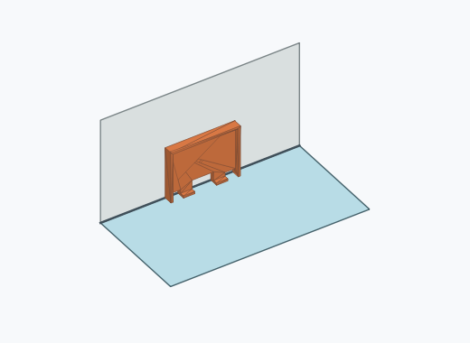 | 616 | 6.16 % | 5.71–6.65 % | 6.23 % |
| Rf4i_0010 | Group 5 | 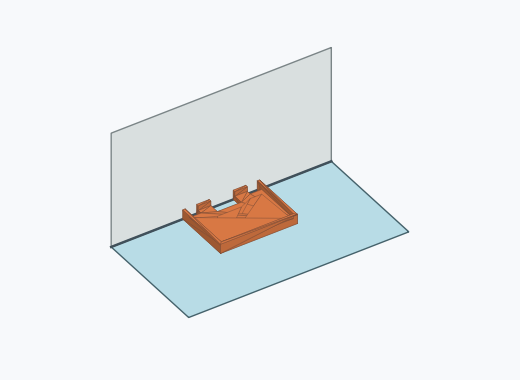 | 571 | 5.71 % | 5.27–6.18 % | 5.78 % |
| Rf4i_0016 | Group 6 | 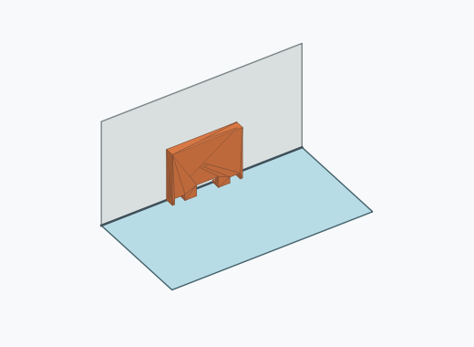 | 557 | 5.57 % | 5.14–6.04 % | 5.63 % |
| Rf4i_0011 | Group 7 | 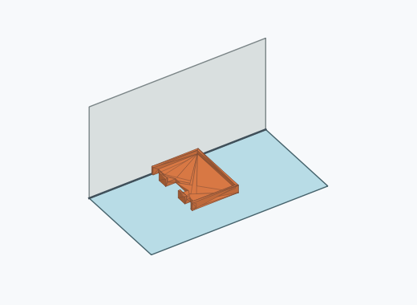 | 550 | 5.50 % | 5.07–5.96 % | 5.56 % |
| Rf4i_0002 | Group 8 |  | 544 | 5.44 % | 5.01–5.90 % | 5.50 % |
| Rf4i_0013 | Group 9 |  | 544 | 5.44 % | 5.01–5.90 % | 5.50 % |
| Rf4i_0009 | Group 10 | 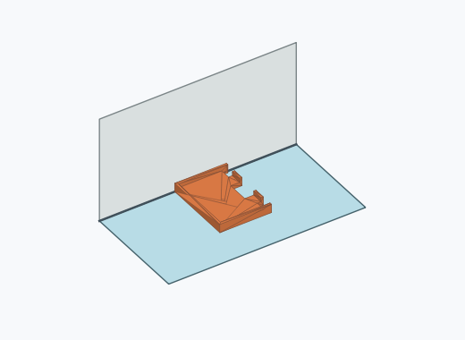 | 499 | 4.99 % | 4.58–5.43 % | 5.05 % |
| Rf4i_0004 | Group 11 | 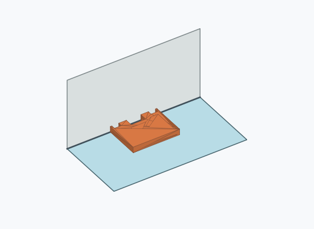 | 496 | 4.96 % | 4.55–5.40 % | 5.02 % |
| Rf4i_0020 | Group 12 |  | 469 | 4.69 % | 4.29–5.12 % | 4.74 % |
| Rf4i_0012 | Group 13 | 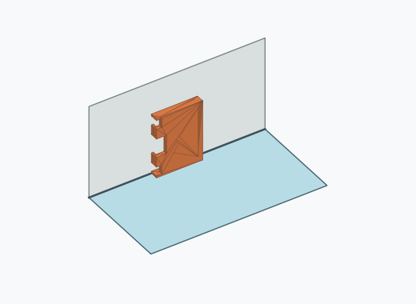 | 466 | 4.66 % | 4.26–5.09 % | 4.71 % |
| Rf4i_0014 | Group 14 | 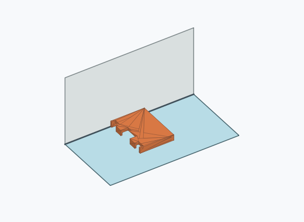 | 443 | 4.43 % | 4.04–4.85 % | 4.48 % |
| Rf4i_0001 | Group 15 | 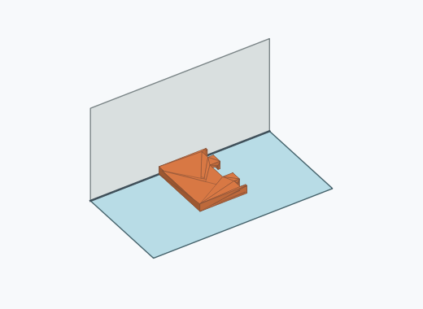 | 396 | 3.96 % | 3.60–4.36 % | 4.01 % |
| Rf4i_0017 | Group 16 |  | 5 | 0.05 % | 0.02–0.12 % | 0.05 % |
| Rf4i_0019 | Group 17 | 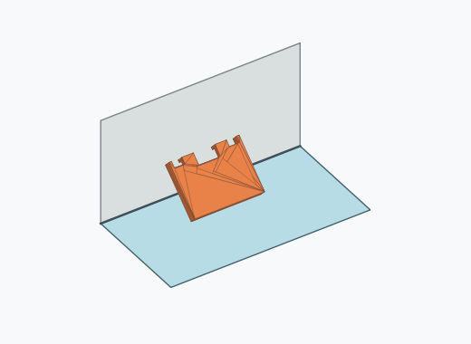 | 4 | 0.04 % | 0.02–0.10 % | 0.04 % |
| Rf4i_0022 | Group 14 |  | 4 | 0.04 % | 0.02–0.10 % | 0.04 % |
| Rf4i_0007 | Group 18 | 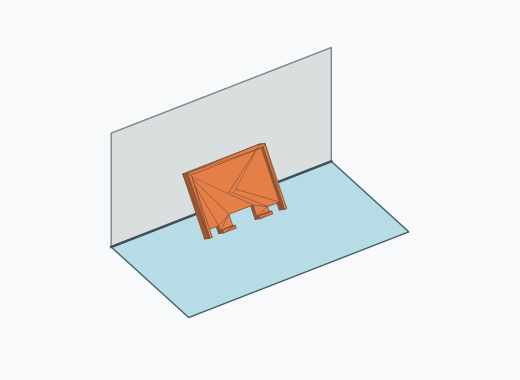 | 3 | 0.03 % | 0.01–0.09 % | 0.03 % |
| Rf4i_0023 | Group 7 | 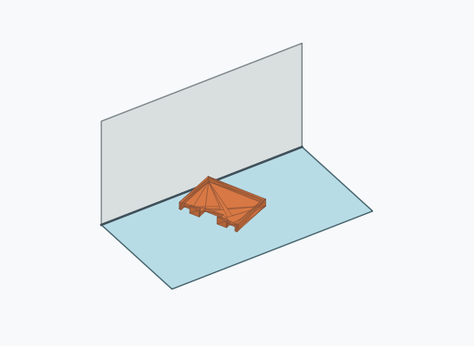 | 3 | 0.03 % | 0.01–0.09 % | 0.03 % |
| Rf4i_0026 | Group 19 |  | 3 | 0.03 % | 0.01–0.09 % | 0.03 % |
| Rf4i_0018 | Group 16 | 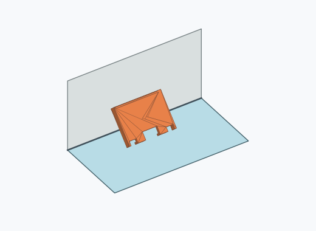 | 2 | 0.02 % | 0.01–0.07 % | 0.02 % |
| Rf4i_0025 | Group 10 |  | 2 | 0.02 % | 0.01–0.07 % | 0.02 % |
| Rf4i_0021 | Group 20 | 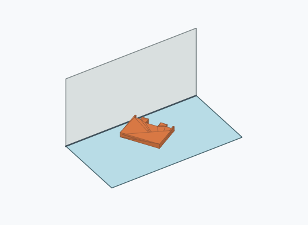 | 1 | 0.01 % | 0.00–0.06 % | 0.01 % |
| Rf4i_0024 | Group 21 | 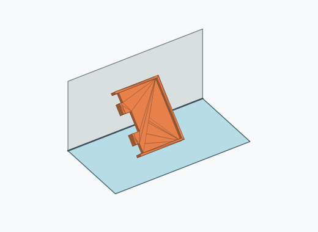 | 1 | 0.01 % | 0.00–0.06 % | 0.01 % |
| Rf4i_0027 | Group 22 | 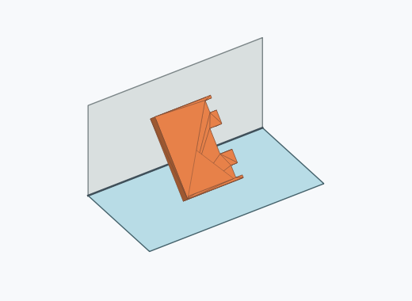 | 1 | 0.01 % | 0.00–0.06 % | 0.01 % |

[Pose catalogue JSON](poses.json) · [Pose catalogue YAML](poses.yaml) · [Frequencies](frequencies.csv) · [Trial records](trials.csv)

Pose orientations use `xyzw` quaternions from the workpiece frame to the chute frame. Recognition uses the recorded symmetry, a 5° tolerance, and a 1° ambiguity margin. The pose registry reserves previously observed IDs for later recognition.

### Historical run files

- [Configuration](config.json)
- [Manifest](manifest.json)
