# Rf4i: grouped observed poses

10,000 completed drops; 9,885 settled. 27 assessed source poses; 16 groups meet the 1% cutoff.

Grouping uses 0.5 mm equivalent lift and a 60° maximum diameter. All members receive the same disturbance protocol.

| Representative | Image | Members | Combined count | Frequency | Retention AUC |
| --- | --- | --- | ---: | ---: | ---: |
| Rf4i_0008 | 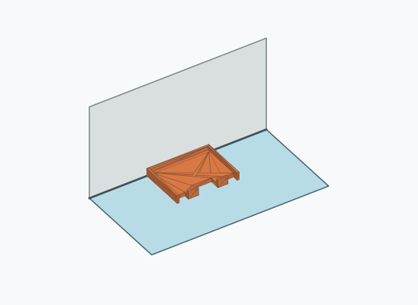 | Rf4i_0008 | 1061 | 10.61% | 1.0000 |
| Rf4i_0005 | 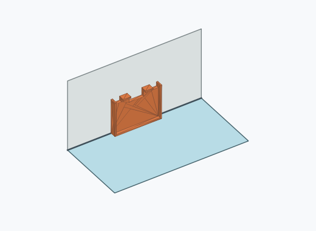 | Rf4i_0005 | 1052 | 10.52% | 1.0000 |
| Rf4i_0015 | 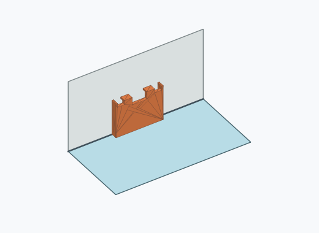 | Rf4i_0015 | 816 | 8.16% | 1.0000 |
| Rf4i_0003 | 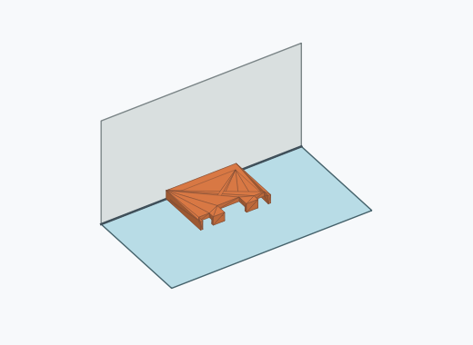 | Rf4i_0003 | 776 | 7.76% | 1.0000 |
| Rf4i_0006 | 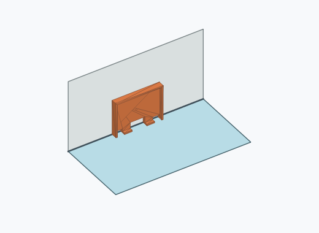 | Rf4i_0006 | 616 | 6.16% | 1.0000 |
| Rf4i_0010 | 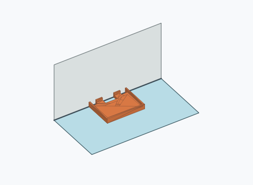 | Rf4i_0010 | 571 | 5.71% | 1.0000 |
| Rf4i_0016 | 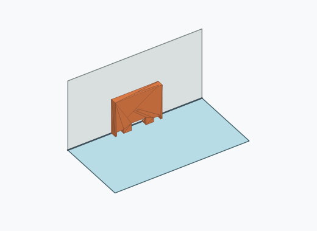 | Rf4i_0016 | 557 | 5.57% | 1.0000 |
| Rf4i_0011 | 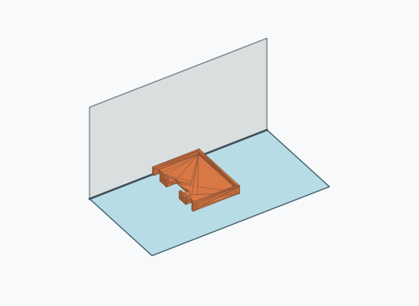 | Rf4i_0011, Rf4i_0023 | 553 | 5.53% | 1.0000 |
| Rf4i_0002 |  | Rf4i_0002 | 544 | 5.44% | 1.0000 |
| Rf4i_0013 |  | Rf4i_0013 | 544 | 5.44% | 1.0000 |
| Rf4i_0009 | 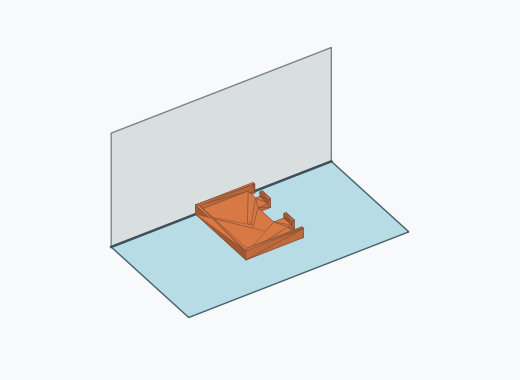 | Rf4i_0009, Rf4i_0025 | 501 | 5.01% | 1.0000 |
| Rf4i_0004 | 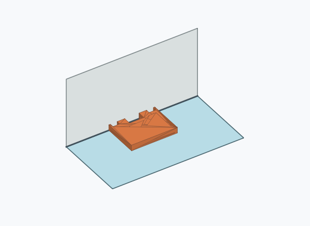 | Rf4i_0004 | 496 | 4.96% | 1.0000 |
| Rf4i_0020 | 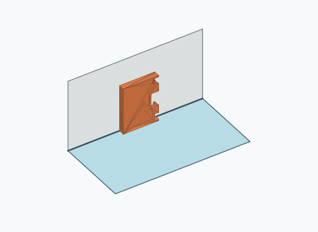 | Rf4i_0020 | 469 | 4.69% | 1.0000 |
| Rf4i_0012 |  | Rf4i_0012 | 466 | 4.66% | 1.0000 |
| Rf4i_0014 | 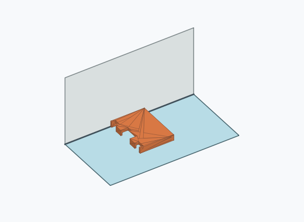 | Rf4i_0014, Rf4i_0022 | 447 | 4.47% | 1.0000 |
| Rf4i_0001 | 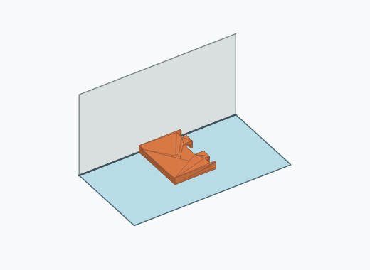 | Rf4i_0001 | 396 | 3.96% | 1.0000 |

[All original observations and member images](original_observations.json), [memberships](membership.csv), [barrier evidence](grouping_geometry.json), [member stability curves](group_stability.csv), [individual disturbance curves](stability.csv), [validation](validation.json).

Frequencies retain the original completed-drop denominator. Stability scores describe the configured virtual chute.
