# Rk1a

[Workpiece index](../README.md#workpieces)

## 10,000-drop paper study

The stationary series recorded **9,970** settled outcomes. The moving series recorded **9,998** settled outcomes at the virtual exit. Each series contains 10,000 drops.

[Study overview](simulations/20261107_10000/README.md) · [Stationary results](simulations/20261107_10000/static/README.md) · [Moving results](simulations/20261107_10000/100mm_s/README.md)

## Historical pose catalogue

Group numbers rank the saved pose basins by their combined incidence within each observation phase. Pose 0 is the most frequent individual pose in its observation phase. The membership CSV links the displayed numbers to the saved pose IDs. Groups below 1% remain visible.

[Group membership CSV](group_memberships.csv) · [Grouping method](../README.md#catalogue-grouping)

### Transport poses

9,976 settled outcomes across 10,000 historical drops on a 500 mm chute. Incidence uses all completed drops as the denominator.

Outcome counts: settled: 9,976, unsettled: 24.

| Pose | Group | Image | Count | Incidence | 95% interval | Share of settled outcomes |
| --- | --- | --- | ---: | ---: | ---: | ---: |
| Pose 0 | Group 0 |  | 717 | 7.17 % | 6.68–7.69 % | 7.19 % |
| Pose 1 | Group 2 | 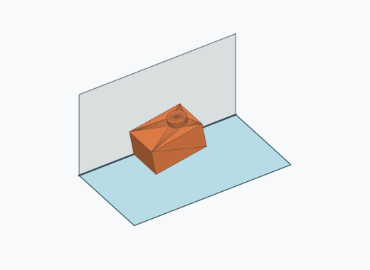 | 656 | 6.56 % | 6.09–7.06 % | 6.58 % |
| Pose 2 | Group 4 | 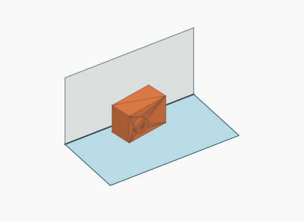 | 640 | 6.40 % | 5.94–6.90 % | 6.42 % |
| Pose 3 | Group 6 |  | 623 | 6.23 % | 5.77–6.72 % | 6.24 % |
| Pose 4 | Group 3 | 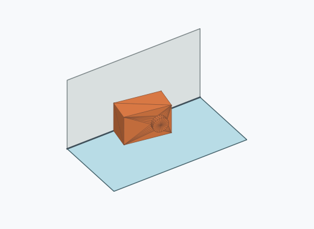 | 604 | 6.04 % | 5.59–6.52 % | 6.05 % |
| Pose 5 | Group 5 |  | 576 | 5.76 % | 5.32–6.23 % | 5.77 % |
| Pose 6 | Group 1 |  | 391 | 3.91 % | 3.55–4.31 % | 3.92 % |
| Pose 7 | Group 7 | 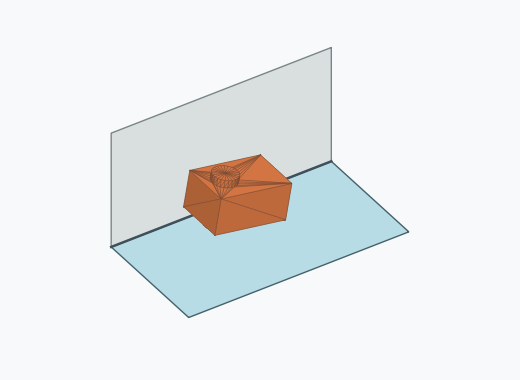 | 385 | 3.85 % | 3.49–4.25 % | 3.86 % |
| Pose 8 | Group 9 |  | 345 | 3.45 % | 3.11–3.83 % | 3.46 % |
| Pose 9 | Group 12 | 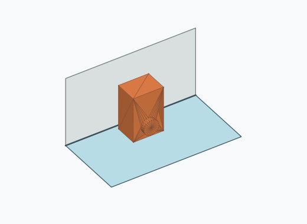 | 321 | 3.21 % | 2.88–3.57 % | 3.22 % |
| Pose 10 | Group 10 |  | 319 | 3.19 % | 2.86–3.55 % | 3.20 % |
| Pose 11 | Group 11 |  | 316 | 3.16 % | 2.83–3.52 % | 3.17 % |
| Pose 12 | Group 8 | 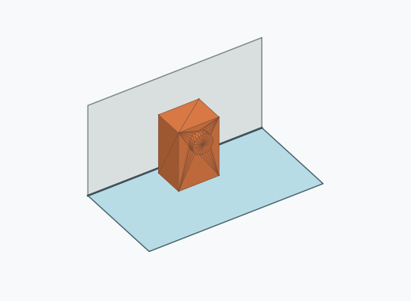 | 267 | 2.67 % | 2.37–3.00 % | 2.68 % |
| Pose 13 | Group 1 |  | 257 | 2.57 % | 2.28–2.90 % | 2.58 % |
| Pose 14 | Group 16 |  | 244 | 2.44 % | 2.16–2.76 % | 2.45 % |
| Pose 15 | Group 17 |  | 243 | 2.43 % | 2.15–2.75 % | 2.44 % |
| Pose 16 | Group 18 | 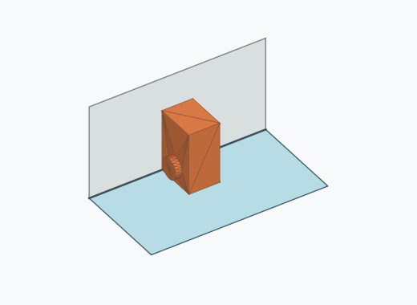 | 238 | 2.38 % | 2.10–2.70 % | 2.39 % |
| Pose 17 | Group 19 |  | 236 | 2.36 % | 2.08–2.68 % | 2.37 % |
| Pose 18 | Group 20 |  | 229 | 2.29 % | 2.01–2.60 % | 2.30 % |
| Pose 19 | Group 21 |  | 223 | 2.23 % | 1.96–2.54 % | 2.24 % |
| Pose 20 | Group 22 | 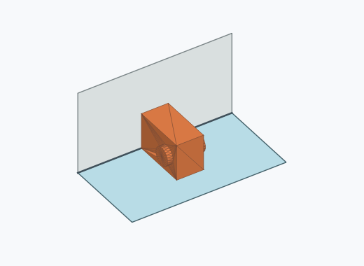 | 218 | 2.18 % | 1.91–2.49 % | 2.19 % |
| Pose 21 | Group 23 |  | 218 | 2.18 % | 1.91–2.49 % | 2.19 % |
| Pose 22 | Group 15 |  | 205 | 2.05 % | 1.79–2.35 % | 2.05 % |
| Pose 23 | Group 7 | 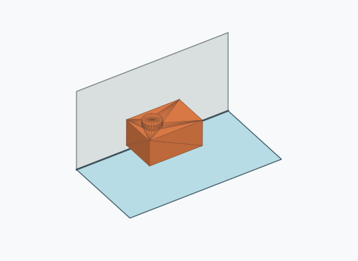 | 205 | 2.05 % | 1.79–2.35 % | 2.05 % |
| Pose 24 | Group 13 | 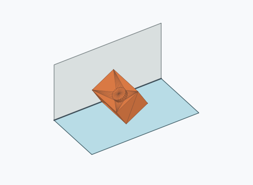 | 189 | 1.89 % | 1.64–2.18 % | 1.89 % |
| Pose 25 | Group 14 |  | 181 | 1.81 % | 1.57–2.09 % | 1.81 % |
| Pose 26 | Group 14 | 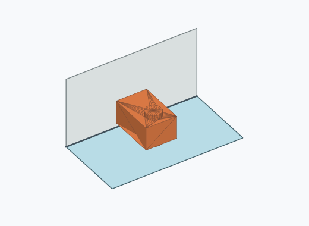 | 155 | 1.55 % | 1.33–1.81 % | 1.55 % |
| Pose 27 | Group 13 |  | 152 | 1.52 % | 1.30–1.78 % | 1.52 % |
| Pose 28 | Group 15 | 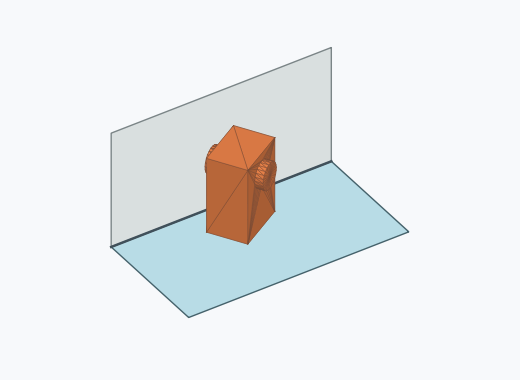 | 127 | 1.27 % | 1.07–1.51 % | 1.27 % |
| Pose 29 | Group 8 |  | 126 | 1.26 % | 1.06–1.50 % | 1.26 % |
| Pose 30 | Group 10 |  | 55 | 0.55 % | 0.42–0.72 % | 0.55 % |
| Pose 31 | Group 11 | 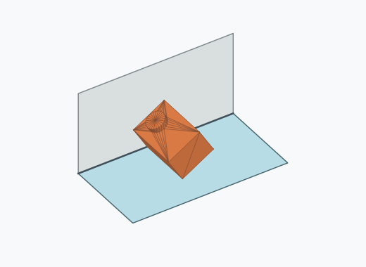 | 51 | 0.51 % | 0.39–0.67 % | 0.51 % |
| Pose 32 | Group 5 | 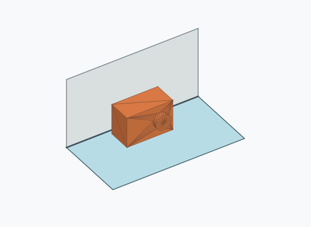 | 43 | 0.43 % | 0.32–0.58 % | 0.43 % |
| Pose 33 | Group 9 | 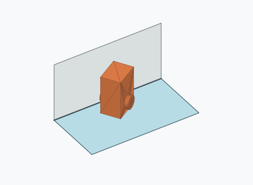 | 41 | 0.41 % | 0.30–0.56 % | 0.41 % |
| Pose 34 | Group 12 |  | 37 | 0.37 % | 0.27–0.51 % | 0.37 % |
| Pose 35 | Group 3 | 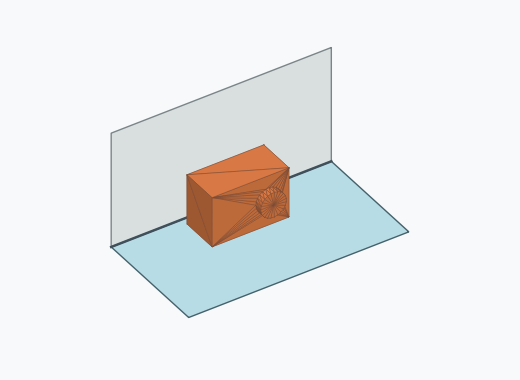 | 34 | 0.34 % | 0.24–0.47 % | 0.34 % |
| Pose 36 | Group 7 |  | 30 | 0.30 % | 0.21–0.43 % | 0.30 % |
| Pose 37 | Group 1 | 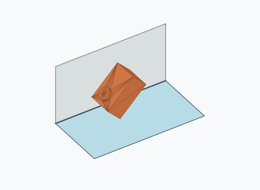 | 25 | 0.25 % | 0.17–0.37 % | 0.25 % |
| Pose 38 | Group 3 |  | 14 | 0.14 % | 0.08–0.23 % | 0.14 % |
| Pose 39 | Group 24 | 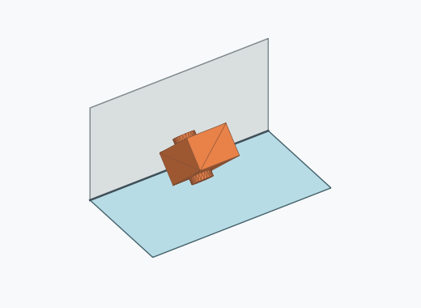 | 13 | 0.13 % | 0.08–0.22 % | 0.13 % |
| Pose 40 | Group 5 | 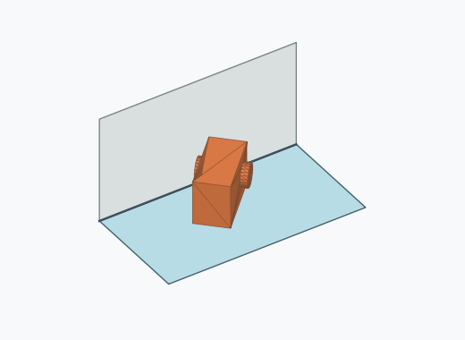 | 11 | 0.11 % | 0.06–0.20 % | 0.11 % |
| Pose 41 | Group 25 |  | 7 | 0.07 % | 0.03–0.14 % | 0.07 % |
| Pose 42 | Group 26 |  | 3 | 0.03 % | 0.01–0.09 % | 0.03 % |
| Pose 43 | Group 27 |  | 3 | 0.03 % | 0.01–0.09 % | 0.03 % |
| Pose 44 | Group 28 |  | 3 | 0.03 % | 0.01–0.09 % | 0.03 % |

[Pose catalogue JSON](poses.json) · [Pose catalogue YAML](poses.yaml) · [Frequencies](frequencies.csv) · [Trial records](trials.csv)

Pose orientations use `xyzw` quaternions from the workpiece frame to the chute frame. Recognition uses the recorded symmetry, a 5° tolerance, and a 1° ambiguity margin. The pose registry reserves previously observed IDs for later recognition.

### Historical run files

- [Configuration](config.json)
- [Manifest](manifest.json)
- [Earlier 1,000-drop comparisons](simulations/README.md)
