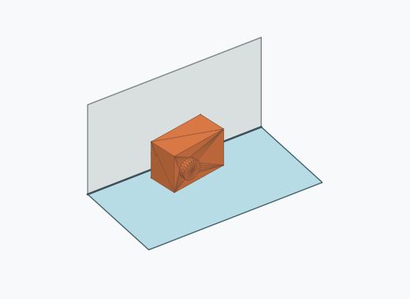
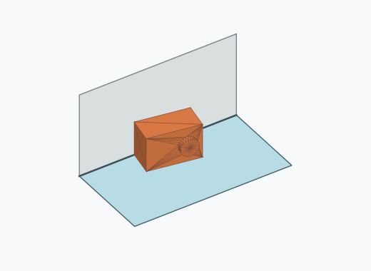
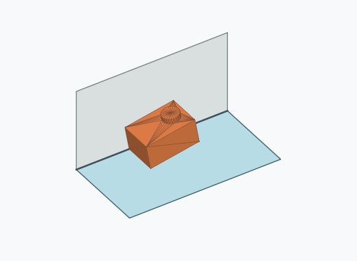
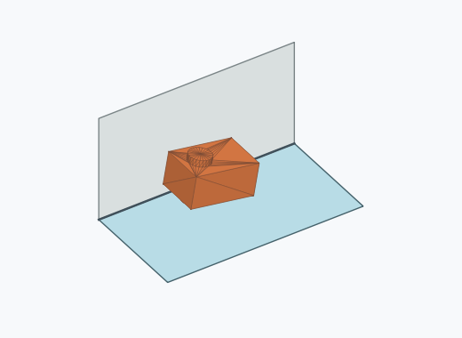
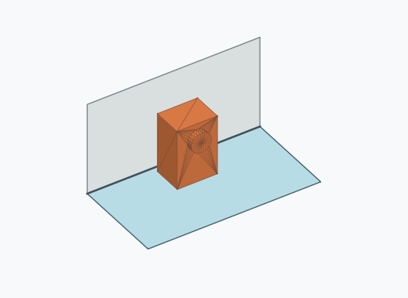
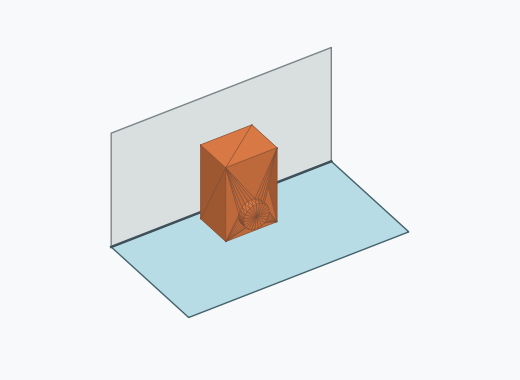
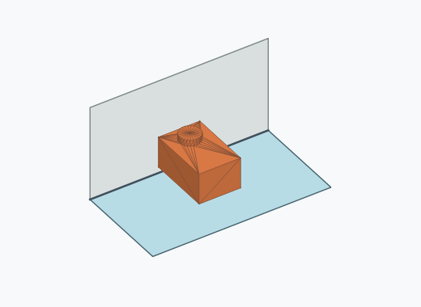
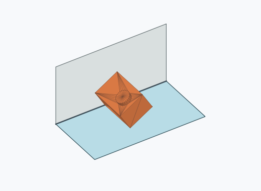
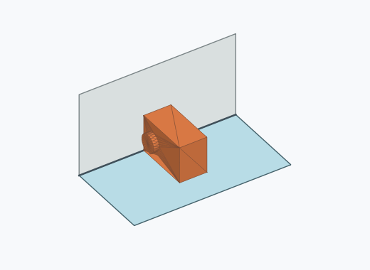
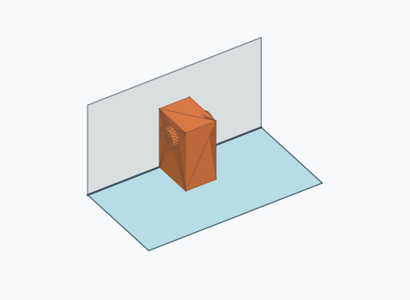

# Rk1a: grouped observed poses

10,000 completed drops; 9,976 settled. 45 assessed source poses; 24 groups meet the 1% cutoff.

Grouping uses 0.5 mm equivalent lift and a 60° maximum diameter. All members receive the same disturbance protocol.

| Representative | Image | Members | Combined count | Frequency | Retention AUC |
| --- | --- | --- | ---: | ---: | ---: |
| Rk1a_0034 |  | Rk1a_0034 | 717 | 7.17% | 1.0000 |
| Rk1a_0007 |  | Rk1a_0006, Rk1a_0007, Rk1a_0043 | 673 | 6.73% | 1.0000 |
| Rk1a_0026 |  | Rk1a_0026 | 656 | 6.56% | 1.0000 |
| Rk1a_0010 |  | Rk1a_0010, Rk1a_0014, Rk1a_0018 | 652 | 6.52% | 1.0000 |
| Rk1a_0011 |  | Rk1a_0011 | 640 | 6.40% | 1.0000 |
| Rk1a_0033 |  | Rk1a_0033, Rk1a_0036, Rk1a_0040 | 630 | 6.30% | 1.0000 |
| Rk1a_0008 |  | Rk1a_0008 | 623 | 6.23% | 1.0000 |
| Rk1a_0022 |  | Rk1a_0022, Rk1a_0029, Rk1a_0031 | 620 | 6.20% | 1.0000 |
| Rk1a_0019 |  | Rk1a_0019, Rk1a_0020 | 393 | 3.93% | 1.0000 |
| Rk1a_0004 |  | Rk1a_0002, Rk1a_0004 | 386 | 3.86% | 1.0000 |
| Rk1a_0035 |  | Rk1a_0032, Rk1a_0035 | 374 | 3.74% | 1.0000 |
| Rk1a_0037 |  | Rk1a_0037, Rk1a_0038 | 367 | 3.67% | 1.0000 |
| Rk1a_0003 |  | Rk1a_0003, Rk1a_0016 | 358 | 3.58% | 1.0000 |
| Rk1a_0009 |  | Rk1a_0009, Rk1a_0012 | 341 | 3.41% | 1.0000 |
| Rk1a_0017 |  | Rk1a_0013, Rk1a_0017 | 336 | 3.36% | 1.0000 |
| Rk1a_0028 |  | Rk1a_0027, Rk1a_0028 | 332 | 3.32% | 1.0000 |
| Rk1a_0042 |  | Rk1a_0042 | 244 | 2.44% | 1.0000 |
| Rk1a_0024 |  | Rk1a_0024 | 243 | 2.43% | 1.0000 |
| Rk1a_0001 |  | Rk1a_0001 | 238 | 2.38% | 1.0000 |
| Rk1a_0021 |  | Rk1a_0021 | 236 | 2.36% | 1.0000 |
| Rk1a_0030 |  | Rk1a_0030 | 229 | 2.29% | 1.0000 |
| Rk1a_0025 |  | Rk1a_0025 | 223 | 2.23% | 1.0000 |
| Rk1a_0005 |  | Rk1a_0005 | 218 | 2.18% | 1.0000 |
| Rk1a_0023 |  | Rk1a_0023 | 218 | 2.18% | 1.0000 |

[All original observations and member images](original_observations.json), [memberships](membership.csv), [barrier evidence](grouping_geometry.json), [member stability curves](group_stability.csv), [individual disturbance curves](stability.csv), [validation](validation.json).

Frequencies retain the original completed-drop denominator. Stability scores describe the configured virtual chute.
