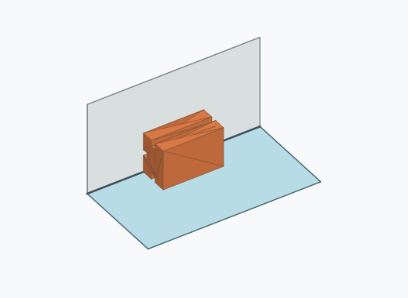
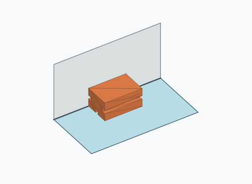
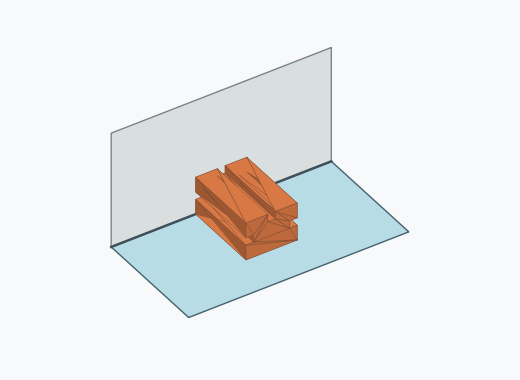
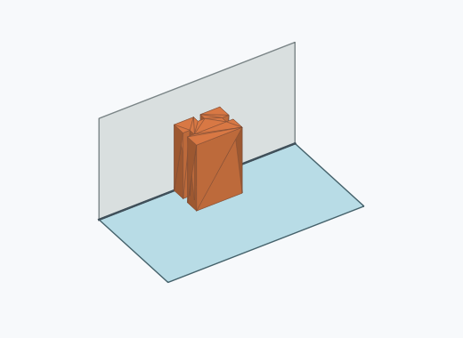
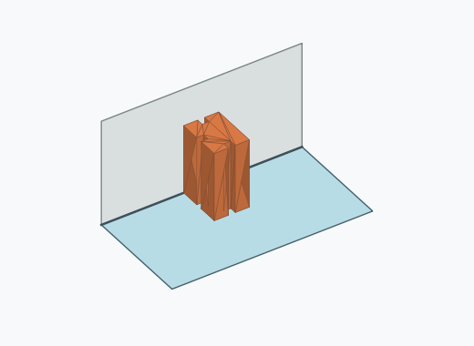
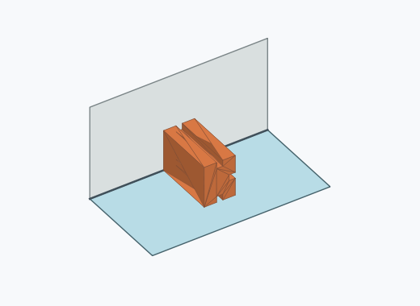

# Rk2i: grouped observed poses

10,000 completed drops; 9,999 settled. 12 assessed source poses; 12 groups meet the 1% cutoff.

Grouping uses 0.5 mm equivalent lift and a 60° maximum diameter. All members receive the same disturbance protocol.

| Representative | Image | Members | Combined count | Frequency | Retention AUC |
| --- | --- | --- | ---: | ---: | ---: |
| Rk2i_0009 |  | Rk2i_0009 | 1342 | 13.42% | 1.0000 |
| Rk2i_0010 |  | Rk2i_0010 | 1298 | 12.98% | 1.0000 |
| Rk2i_0003 |  | Rk2i_0003 | 1297 | 12.97% | 1.0000 |
| Rk2i_0006 |  | Rk2i_0006 | 1255 | 12.55% | 1.0000 |
| Rk2i_0002 |  | Rk2i_0002 | 818 | 8.18% | 1.0000 |
| Rk2i_0008 |  | Rk2i_0008 | 751 | 7.51% | 1.0000 |
| Rk2i_0005 |  | Rk2i_0005 | 708 | 7.08% | 1.0000 |
| Rk2i_0007 |  | Rk2i_0007 | 707 | 7.07% | 1.0000 |
| Rk2i_0001 |  | Rk2i_0001 | 474 | 4.74% | 1.0000 |
| Rk2i_0012 |  | Rk2i_0012 | 472 | 4.72% | 1.0000 |
| Rk2i_0004 |  | Rk2i_0004 | 452 | 4.52% | 0.9922 |
| Rk2i_0011 |  | Rk2i_0011 | 425 | 4.25% | 1.0000 |

[All original observations and member images](original_observations.json), [memberships](membership.csv), [barrier evidence](grouping_geometry.json), [member stability curves](group_stability.csv), [individual disturbance curves](stability.csv), [validation](validation.json).

Frequencies retain the original completed-drop denominator. Stability scores describe the configured virtual chute.
