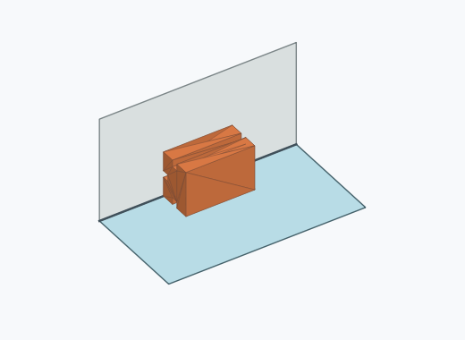
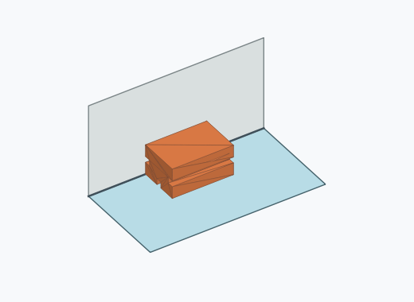
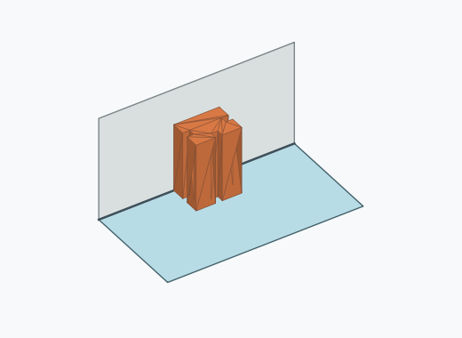
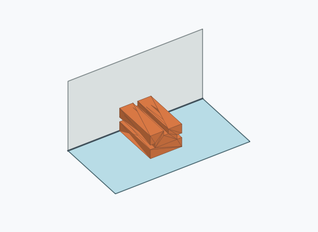
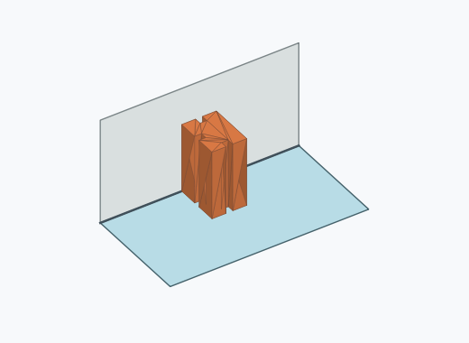
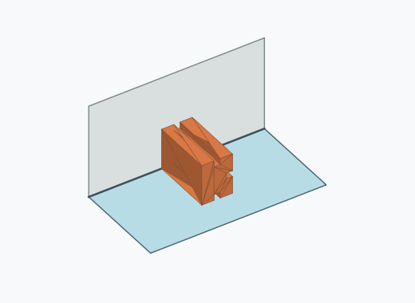

# Rk2i

[Workpiece index](../README.md#workpieces)

## Historical pose catalogue

Group numbers rank the saved pose basins by their combined incidence within each observation phase. Pose 0 is the most frequent individual pose in its observation phase. The membership CSV links the displayed numbers to the saved pose IDs. Groups below 1% remain visible.

[Group membership CSV](group_memberships.csv) · [Grouping method](../README.md#catalogue-grouping)

### Transport poses

9,999 settled outcomes across 10,000 historical drops on a 500 mm chute. Incidence uses all completed drops as the denominator.

Outcome counts: settled: 9,999, unsettled: 1.

| Pose | Group | Image | Count | Incidence | 95% interval | Share of settled outcomes |
| --- | --- | --- | ---: | ---: | ---: | ---: |
| Pose 0 | Group 0 |  | 1342 | 13.42 % | 12.77–14.10 % | 13.42 % |
| Pose 1 | Group 1 |  | 1298 | 12.98 % | 12.34–13.65 % | 12.98 % |
| Pose 2 | Group 2 |  | 1297 | 12.97 % | 12.33–13.64 % | 12.97 % |
| Pose 3 | Group 3 |  | 1255 | 12.55 % | 11.92–13.21 % | 12.55 % |
| Pose 4 | Group 4 |  | 818 | 8.18 % | 7.66–8.73 % | 8.18 % |
| Pose 5 | Group 5 |  | 751 | 7.51 % | 7.01–8.04 % | 7.51 % |
| Pose 6 | Group 6 |  | 708 | 7.08 % | 6.59–7.60 % | 7.08 % |
| Pose 7 | Group 7 |  | 707 | 7.07 % | 6.58–7.59 % | 7.07 % |
| Pose 8 | Group 8 |  | 474 | 4.74 % | 4.34–5.17 % | 4.74 % |
| Pose 9 | Group 9 |  | 472 | 4.72 % | 4.32–5.15 % | 4.72 % |
| Pose 10 | Group 10 |  | 452 | 4.52 % | 4.13–4.94 % | 4.52 % |
| Pose 11 | Group 11 |  | 425 | 4.25 % | 3.87–4.66 % | 4.25 % |

[Pose catalogue JSON](poses.json) · [Pose catalogue YAML](poses.yaml) · [Frequencies](frequencies.csv) · [Trial records](trials.csv)

Pose orientations use `xyzw` quaternions from the workpiece frame to the chute frame. Recognition uses the recorded symmetry, a 5° tolerance, and a 1° ambiguity margin. The pose registry reserves previously observed IDs for later recognition.

### Historical run files

- [Configuration](config.json)
- [Manifest](manifest.json)
