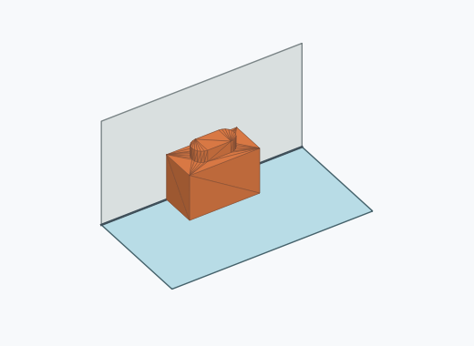
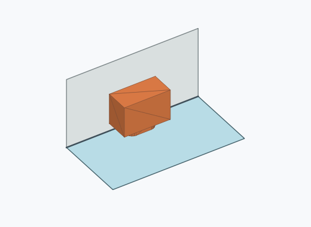
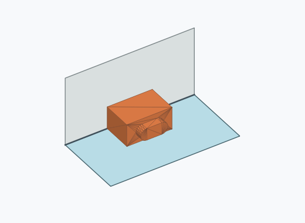
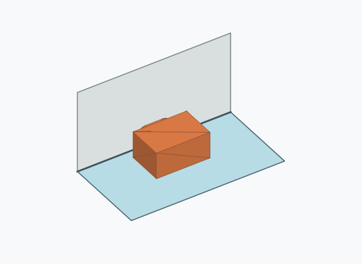
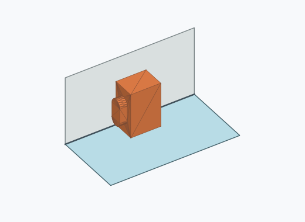
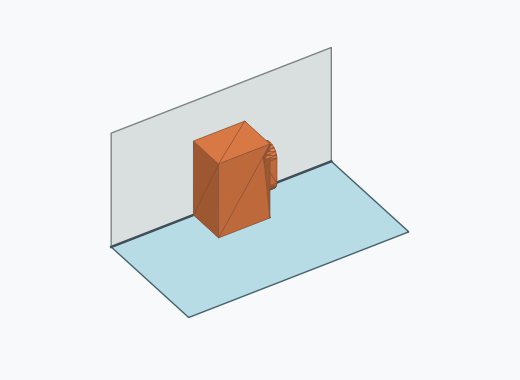
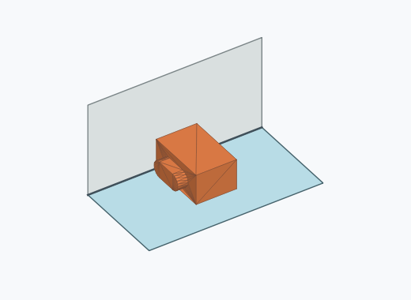
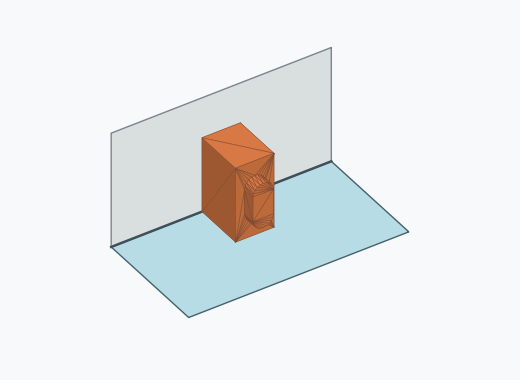
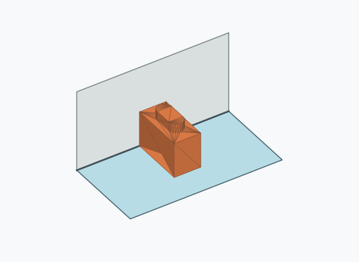
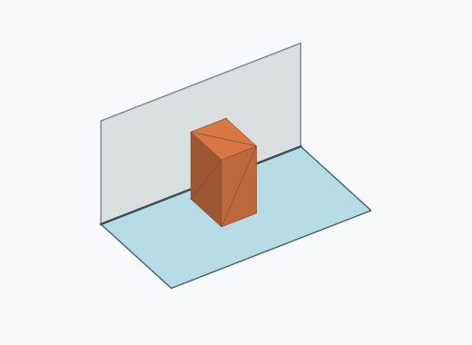

# Rk3a: grouped observed poses

10,000 completed drops; 9,995 settled. 17 assessed source poses; 11 groups meet the 1% cutoff.

Grouping uses 0.5 mm equivalent lift and a 60° maximum diameter. All members receive the same disturbance protocol.

| Representative | Image | Members | Combined count | Frequency | Retention AUC |
| --- | --- | --- | ---: | ---: | ---: |
| Rk3a_0014 |  | Rk3a_0014 | 1349 | 13.49% | 1.0000 |
| Rk3a_0010 |  | Rk3a_0007, Rk3a_0010 | 1310 | 13.10% | 1.0000 |
| Rk3a_0012 |  | Rk3a_0012 | 1267 | 12.67% | 1.0000 |
| Rk3a_0004 |  | Rk3a_0004, Rk3a_0006 | 1215 | 12.15% | 1.0000 |
| Rk3a_0003 |  | Rk3a_0003 | 1035 | 10.35% | 1.0000 |
| Rk3a_0009 |  | Rk3a_0009 | 1027 | 10.27% | 1.0000 |
| Rk3a_0002 |  | Rk3a_0002 | 899 | 8.99% | 1.0000 |
| Rk3a_0008 |  | Rk3a_0008 | 849 | 8.49% | 1.0000 |
| Rk3a_0011 |  | Rk3a_0011 | 426 | 4.26% | 1.0000 |
| Rk3a_0013 |  | Rk3a_0013 | 409 | 4.09% | 1.0000 |
| Rk3a_0001 |  | Rk3a_0001 | 133 | 1.33% | 0.9844 |

[All original observations and member images](original_observations.json), [memberships](membership.csv), [barrier evidence](grouping_geometry.json), [member stability curves](group_stability.csv), [individual disturbance curves](stability.csv), [validation](validation.json).

Frequencies retain the original completed-drop denominator. Stability scores describe the configured virtual chute.
