# Rk3a

[Workpiece index](../README.md#workpieces)

## Historical pose catalogue

Group numbers rank the saved pose basins by their combined incidence within each observation phase. The percentages in the table describe each individual pose. Groups below 1% remain visible.

[Group membership CSV](group_memberships.csv) · [Grouping method](../README.md#catalogue-grouping)

### Transport poses

9,995 settled outcomes across 10,000 historical drops on a 500 mm chute. Incidence uses all completed drops as the denominator.

Outcome counts: settled: 9,995, unsettled: 5.

| Pose | Group | Image | Count | Incidence | 95% interval | Share of settled outcomes |
| --- | --- | --- | ---: | ---: | ---: | ---: |
| Rk3a_0014 | Group 0 | 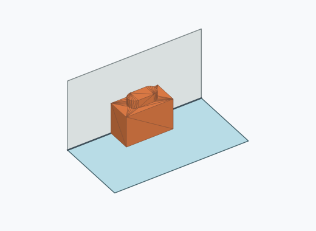 | 1349 | 13.49 % | 12.83–14.17 % | 13.50 % |
| Rk3a_0012 | Group 2 | 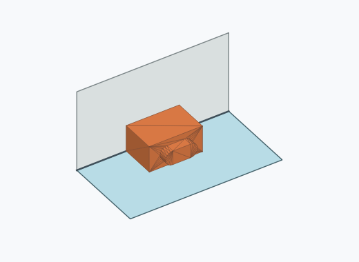 | 1267 | 12.67 % | 12.03–13.34 % | 12.68 % |
| Rk3a_0010 | Group 1 | 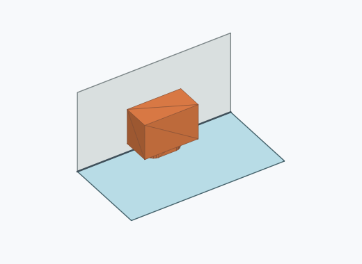 | 1109 | 11.09 % | 10.49–11.72 % | 11.10 % |
| Rk3a_0004 | Group 3 | 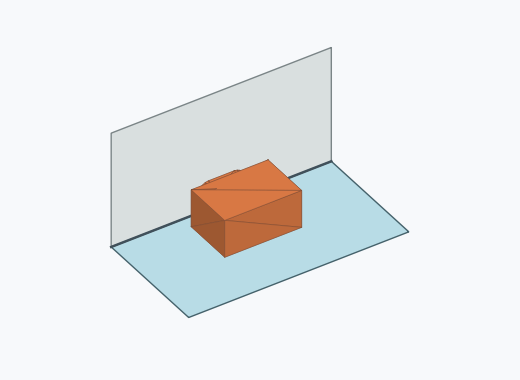 | 1053 | 10.53 % | 9.94–11.15 % | 10.54 % |
| Rk3a_0003 | Group 4 | 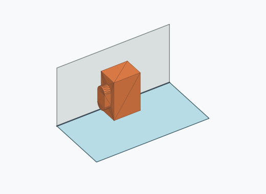 | 1035 | 10.35 % | 9.77–10.96 % | 10.36 % |
| Rk3a_0009 | Group 5 | 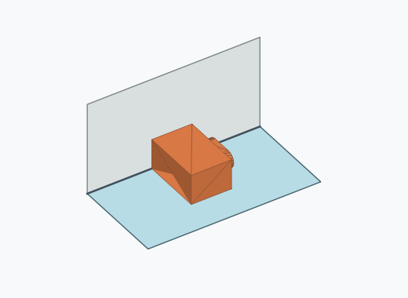 | 1027 | 10.27 % | 9.69–10.88 % | 10.28 % |
| Rk3a_0002 | Group 6 | 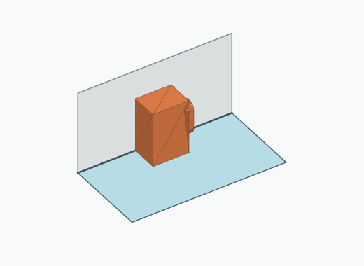 | 899 | 8.99 % | 8.45–9.57 % | 8.99 % |
| Rk3a_0008 | Group 7 |  | 849 | 8.49 % | 7.96–9.05 % | 8.49 % |
| Rk3a_0011 | Group 8 | 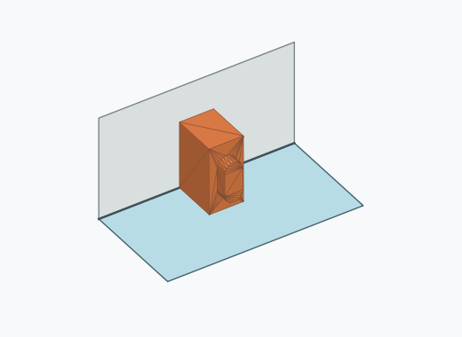 | 426 | 4.26 % | 3.88–4.67 % | 4.26 % |
| Rk3a_0013 | Group 9 | 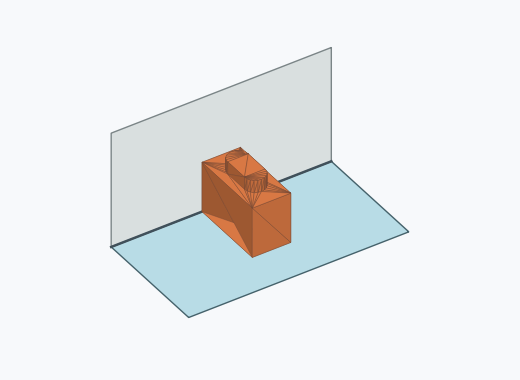 | 409 | 4.09 % | 3.72–4.50 % | 4.09 % |
| Rk3a_0007 | Group 1 | 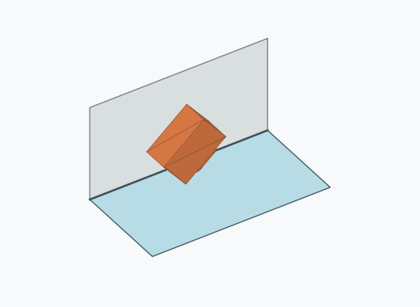 | 201 | 2.01 % | 1.75–2.30 % | 2.01 % |
| Rk3a_0006 | Group 3 | 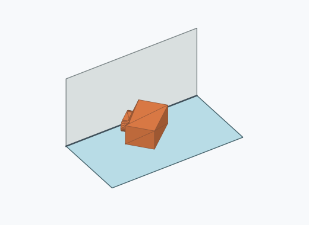 | 162 | 1.62 % | 1.39–1.89 % | 1.62 % |
| Rk3a_0001 | Group 10 | 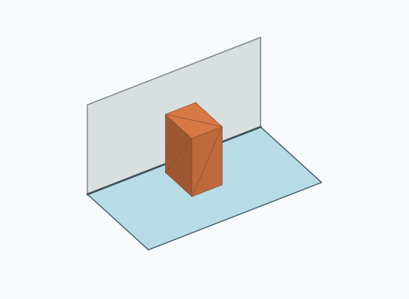 | 133 | 1.33 % | 1.12–1.57 % | 1.33 % |
| Rk3a_0005 | Group 11 | 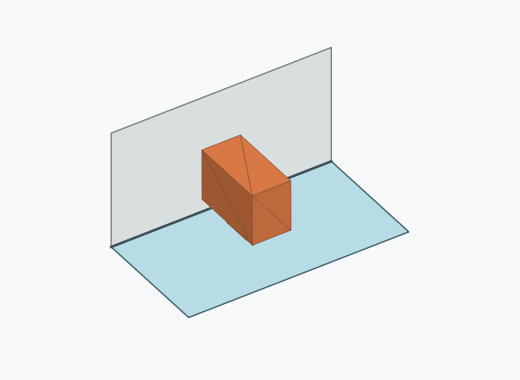 | 61 | 0.61 % | 0.48–0.78 % | 0.61 % |
| Rk3a_0016 | Group 12 | 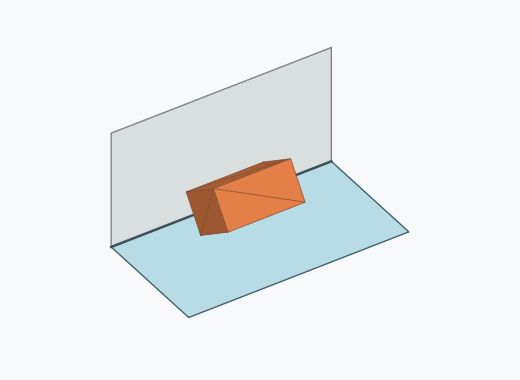 | 12 | 0.12 % | 0.07–0.21 % | 0.12 % |
| Rk3a_0017 | Group 12 | 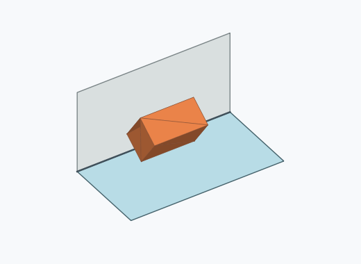 | 2 | 0.02 % | 0.01–0.07 % | 0.02 % |
| Rk3a_0015 | Group 13 | 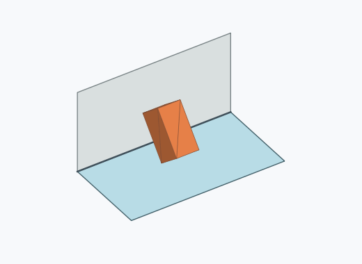 | 1 | 0.01 % | 0.00–0.06 % | 0.01 % |

[Pose catalogue JSON](poses.json) · [Pose catalogue YAML](poses.yaml) · [Frequencies](frequencies.csv) · [Trial records](trials.csv)

Pose orientations use `xyzw` quaternions from the workpiece frame to the chute frame. Recognition uses the recorded symmetry, a 5° tolerance, and a 1° ambiguity margin. The pose registry reserves previously observed IDs for later recognition.

### Historical run files

- [Configuration](config.json)
- [Manifest](manifest.json)
