# Rk4i: grouped observed poses

10,000 completed drops; 9,999 settled. 24 assessed source poses; 24 groups meet the 1% cutoff.

Grouping uses 0.5 mm equivalent lift and a 60° maximum diameter. All members receive the same disturbance protocol.

| Representative | Image | Members | Combined count | Frequency | Retention AUC |
| --- | --- | --- | ---: | ---: | ---: |
| Rk4i_0006 | 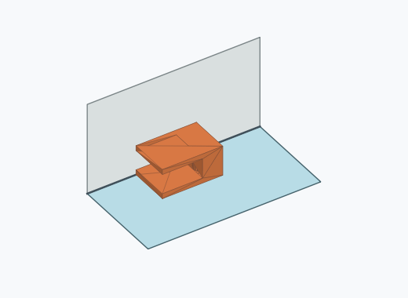 | Rk4i_0006 | 623 | 6.23% | 1.0000 |
| Rk4i_0020 | 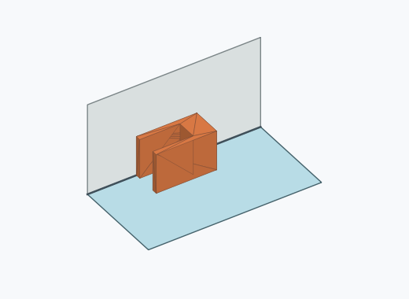 | Rk4i_0020 | 623 | 6.23% | 1.0000 |
| Rk4i_0011 |  | Rk4i_0011 | 621 | 6.21% | 1.0000 |
| Rk4i_0019 | 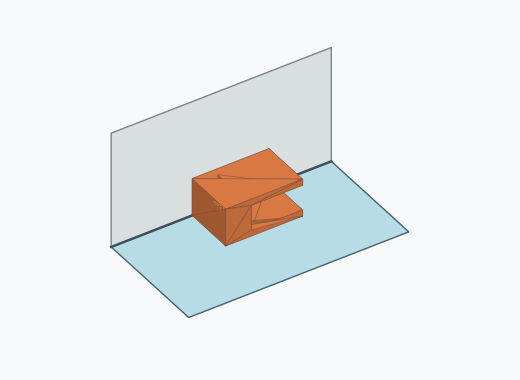 | Rk4i_0019 | 621 | 6.21% | 1.0000 |
| Rk4i_0012 | 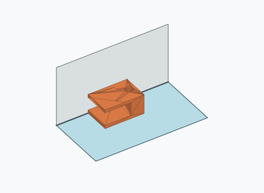 | Rk4i_0012 | 616 | 6.16% | 1.0000 |
| Rk4i_0008 | 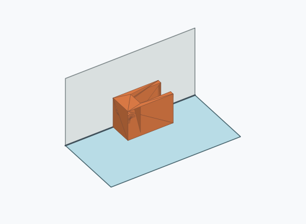 | Rk4i_0008 | 610 | 6.10% | 1.0000 |
| Rk4i_0005 |  | Rk4i_0005 | 602 | 6.02% | 1.0000 |
| Rk4i_0021 |  | Rk4i_0021 | 601 | 6.01% | 1.0000 |
| Rk4i_0010 |  | Rk4i_0010 | 590 | 5.90% | 1.0000 |
| Rk4i_0009 | 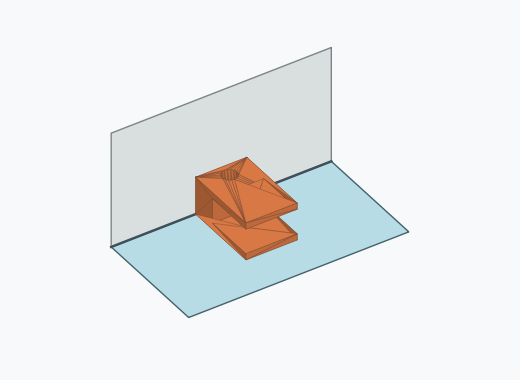 | Rk4i_0009 | 560 | 5.60% | 1.0000 |
| Rk4i_0007 | 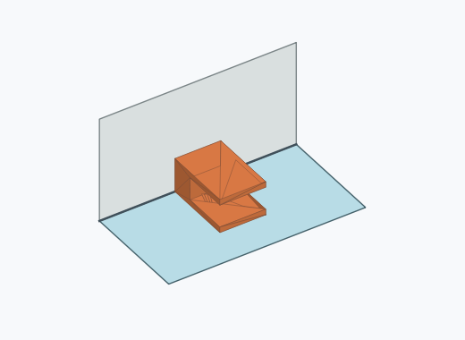 | Rk4i_0007 | 544 | 5.44% | 1.0000 |
| Rk4i_0013 | 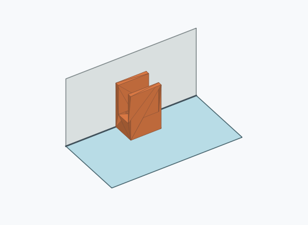 | Rk4i_0013 | 533 | 5.33% | 1.0000 |
| Rk4i_0016 |  | Rk4i_0016 | 379 | 3.79% | 1.0000 |
| Rk4i_0002 | 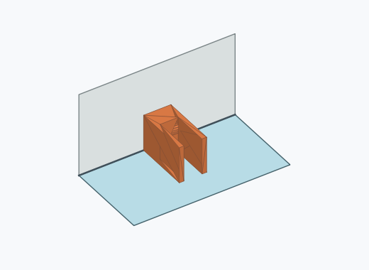 | Rk4i_0002 | 356 | 3.56% | 1.0000 |
| Rk4i_0017 | 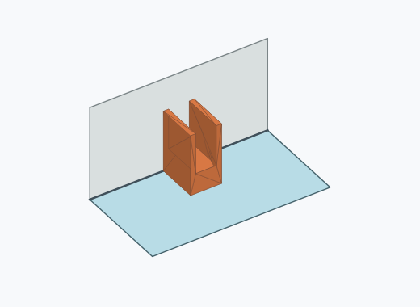 | Rk4i_0017 | 349 | 3.49% | 1.0000 |
| Rk4i_0014 |  | Rk4i_0014 | 347 | 3.47% | 1.0000 |
| Rk4i_0023 | 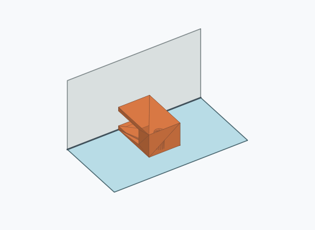 | Rk4i_0023 | 236 | 2.36% | 1.0000 |
| Rk4i_0022 | 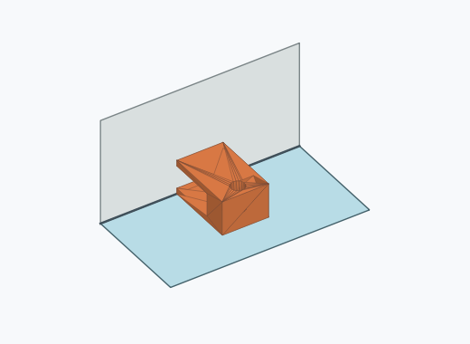 | Rk4i_0022 | 230 | 2.30% | 1.0000 |
| Rk4i_0004 |  | Rk4i_0004 | 228 | 2.28% | 1.0000 |
| Rk4i_0003 |  | Rk4i_0003 | 196 | 1.96% | 1.0000 |
| Rk4i_0024 |  | Rk4i_0024 | 143 | 1.43% | 1.0000 |
| Rk4i_0015 | 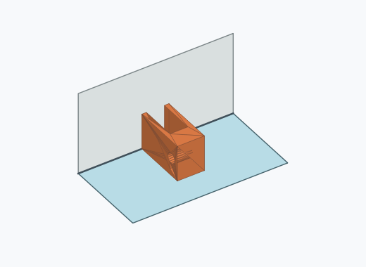 | Rk4i_0015 | 135 | 1.35% | 1.0000 |
| Rk4i_0018 | 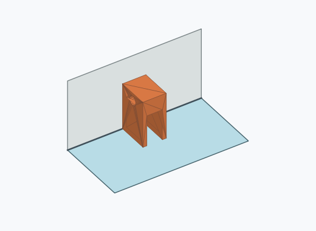 | Rk4i_0018 | 133 | 1.33% | 1.0000 |
| Rk4i_0001 |  | Rk4i_0001 | 123 | 1.23% | 1.0000 |

[All original observations and member images](original_observations.json), [memberships](membership.csv), [barrier evidence](grouping_geometry.json), [member stability curves](group_stability.csv), [individual disturbance curves](stability.csv), [validation](validation.json).

Frequencies retain the original completed-drop denominator. Stability scores describe the configured virtual chute.
