# Rk4i

[Workpiece index](../README.md#workpieces)

## Historical pose catalogue

Group numbers rank the saved pose basins by their combined incidence within each observation phase. The percentages in the table describe each individual pose. Groups below 1% remain visible.

[Group membership CSV](group_memberships.csv) · [Grouping method](../README.md#catalogue-grouping)

### Transport poses

9,999 settled outcomes across 10,000 historical drops on a 500 mm chute. Incidence uses all completed drops as the denominator.

Outcome counts: settled: 9,999, unsettled: 1.

| Pose | Group | Image | Count | Incidence | 95% interval | Share of settled outcomes |
| --- | --- | --- | ---: | ---: | ---: | ---: |
| Rk4i_0006 | Group 0 | 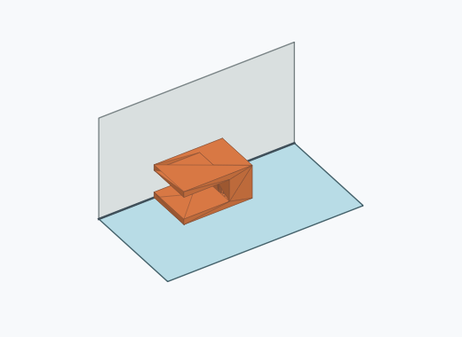 | 623 | 6.23 % | 5.77–6.72 % | 6.23 % |
| Rk4i_0020 | Group 1 |  | 623 | 6.23 % | 5.77–6.72 % | 6.23 % |
| Rk4i_0011 | Group 2 | 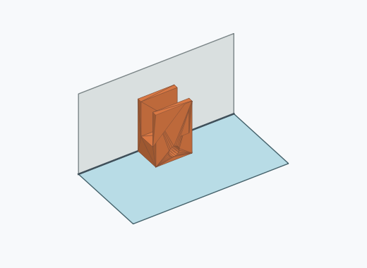 | 621 | 6.21 % | 5.75–6.70 % | 6.21 % |
| Rk4i_0019 | Group 3 |  | 621 | 6.21 % | 5.75–6.70 % | 6.21 % |
| Rk4i_0012 | Group 4 | 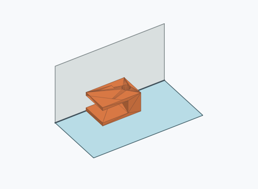 | 616 | 6.16 % | 5.71–6.65 % | 6.16 % |
| Rk4i_0008 | Group 5 |  | 610 | 6.10 % | 5.65–6.59 % | 6.10 % |
| Rk4i_0005 | Group 6 | 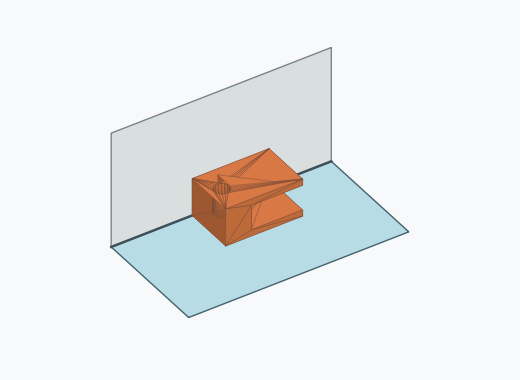 | 602 | 6.02 % | 5.57–6.50 % | 6.02 % |
| Rk4i_0021 | Group 7 | 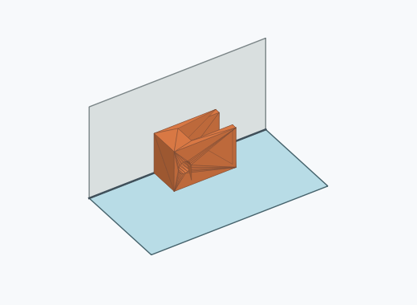 | 601 | 6.01 % | 5.56–6.49 % | 6.01 % |
| Rk4i_0010 | Group 8 | 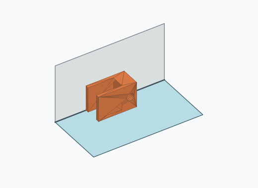 | 590 | 5.90 % | 5.45–6.38 % | 5.90 % |
| Rk4i_0009 | Group 9 | 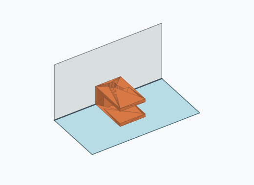 | 560 | 5.60 % | 5.17–6.07 % | 5.60 % |
| Rk4i_0007 | Group 10 | 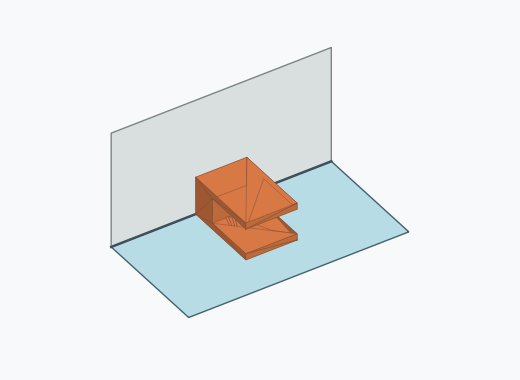 | 544 | 5.44 % | 5.01–5.90 % | 5.44 % |
| Rk4i_0013 | Group 11 |  | 533 | 5.33 % | 4.91–5.79 % | 5.33 % |
| Rk4i_0016 | Group 12 |  | 379 | 3.79 % | 3.43–4.18 % | 3.79 % |
| Rk4i_0002 | Group 13 | 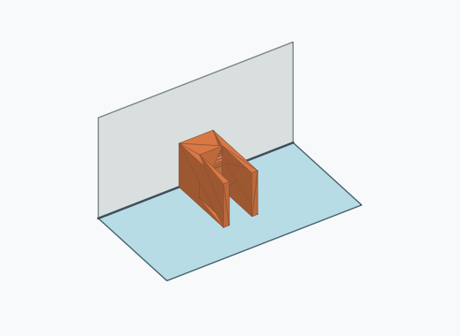 | 356 | 3.56 % | 3.21–3.94 % | 3.56 % |
| Rk4i_0017 | Group 14 | 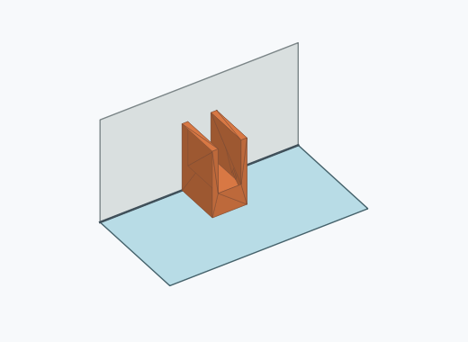 | 349 | 3.49 % | 3.15–3.87 % | 3.49 % |
| Rk4i_0014 | Group 15 |  | 347 | 3.47 % | 3.13–3.85 % | 3.47 % |
| Rk4i_0023 | Group 16 | 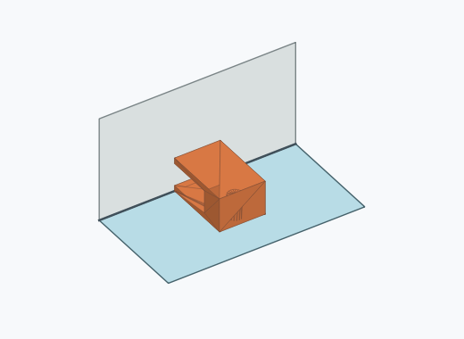 | 236 | 2.36 % | 2.08–2.68 % | 2.36 % |
| Rk4i_0022 | Group 17 | 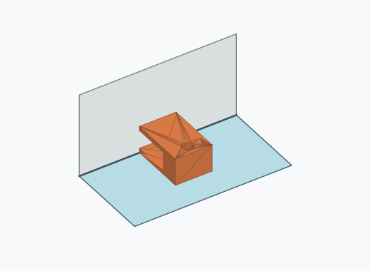 | 230 | 2.30 % | 2.02–2.61 % | 2.30 % |
| Rk4i_0004 | Group 18 |  | 228 | 2.28 % | 2.01–2.59 % | 2.28 % |
| Rk4i_0003 | Group 19 |  | 196 | 1.96 % | 1.71–2.25 % | 1.96 % |
| Rk4i_0024 | Group 20 |  | 143 | 1.43 % | 1.22–1.68 % | 1.43 % |
| Rk4i_0015 | Group 21 | 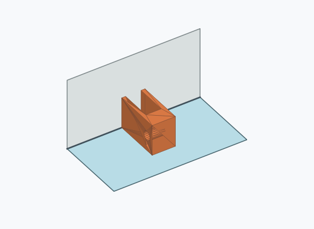 | 135 | 1.35 % | 1.14–1.60 % | 1.35 % |
| Rk4i_0018 | Group 22 | 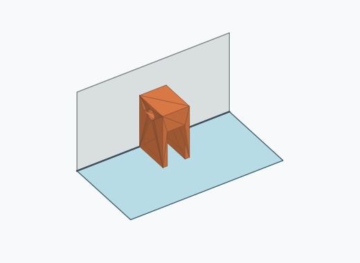 | 133 | 1.33 % | 1.12–1.57 % | 1.33 % |
| Rk4i_0001 | Group 23 |  | 123 | 1.23 % | 1.03–1.47 % | 1.23 % |

[Pose catalogue JSON](poses.json) · [Pose catalogue YAML](poses.yaml) · [Frequencies](frequencies.csv) · [Trial records](trials.csv)

Pose orientations use `xyzw` quaternions from the workpiece frame to the chute frame. Recognition uses the recorded symmetry, a 5° tolerance, and a 1° ambiguity margin. The pose registry reserves previously observed IDs for later recognition.

### Historical run files

- [Configuration](config.json)
- [Manifest](manifest.json)
