# Rl1a

[Workpiece index](../README.md#workpieces)

## 10,000-drop paper study

The stationary series recorded **9,994** settled outcomes. The moving series recorded **9,996** settled outcomes at the virtual exit. Each series contains 10,000 drops.

[Study overview](simulations/20261107_10000/README.md) · [Stationary results](simulations/20261107_10000/static/README.md) · [Moving results](simulations/20261107_10000/100mm_s/README.md)

## Historical pose catalogue

Group numbers rank the saved pose basins by their combined incidence within each observation phase. Pose 0 is the most frequent individual pose in its observation phase. The membership CSV links the displayed numbers to the saved pose IDs. Groups below 1% remain visible.

[Group membership CSV](group_memberships.csv) · [Grouping method](../README.md#catalogue-grouping)

### Transport poses

9,830 settled outcomes across 10,000 historical drops on a 500 mm chute. Incidence uses all completed drops as the denominator.

Outcome counts: settled: 9,830, unsettled: 170.

| Pose | Group | Image | Count | Incidence | 95% interval | Share of settled outcomes |
| --- | --- | --- | ---: | ---: | ---: | ---: |
| Pose 0 | Group 0 |  | 2462 | 24.62 % | 23.79–25.47 % | 25.05 % |
| Pose 1 | Group 1 | 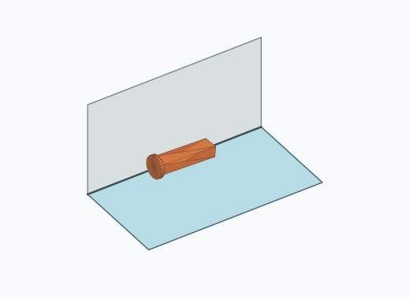 | 2234 | 22.34 % | 21.53–23.17 % | 22.73 % |
| Pose 2 | Group 2 | 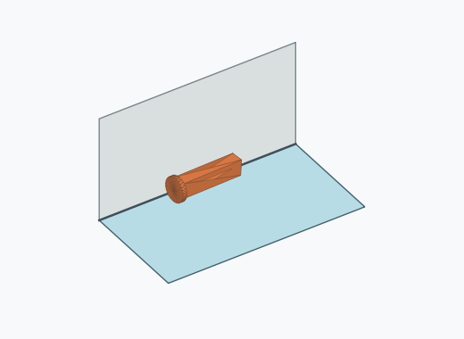 | 2221 | 22.21 % | 21.41–23.04 % | 22.59 % |
| Pose 3 | Group 3 | 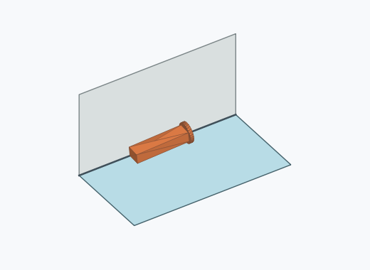 | 2156 | 21.56 % | 20.76–22.38 % | 21.93 % |
| Pose 4 | Group 4 | 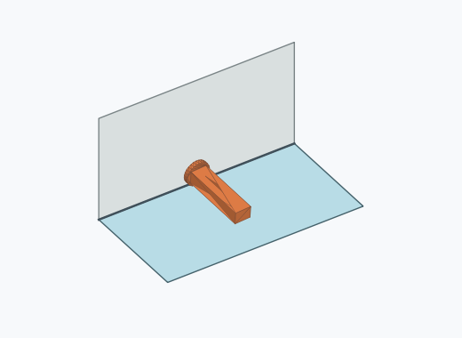 | 259 | 2.59 % | 2.30–2.92 % | 2.63 % |
| Pose 5 | Group 5 | 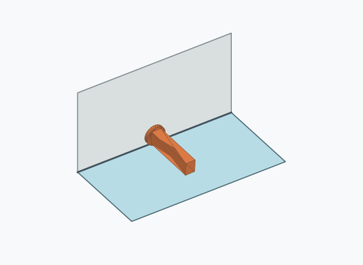 | 167 | 1.67 % | 1.44–1.94 % | 1.70 % |
| Pose 6 | Group 6 |  | 87 | 0.87 % | 0.71–1.07 % | 0.89 % |
| Pose 7 | Group 6 | 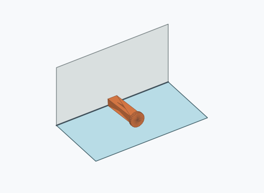 | 62 | 0.62 % | 0.48–0.79 % | 0.63 % |
| Pose 8 | Group 7 | 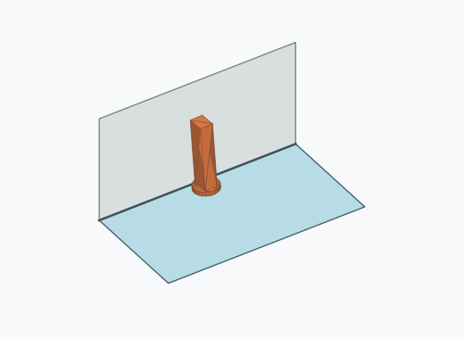 | 48 | 0.48 % | 0.36–0.64 % | 0.49 % |
| Pose 9 | Group 8 |  | 19 | 0.19 % | 0.12–0.30 % | 0.19 % |
| Pose 10 | Group 10 | 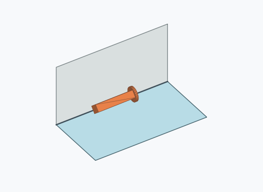 | 18 | 0.18 % | 0.11–0.28 % | 0.18 % |
| Pose 11 | Group 11 |  | 16 | 0.16 % | 0.10–0.26 % | 0.16 % |
| Pose 12 | Group 9 | 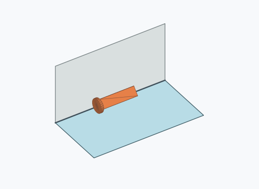 | 16 | 0.16 % | 0.10–0.26 % | 0.16 % |
| Pose 13 | Group 7 |  | 11 | 0.11 % | 0.06–0.20 % | 0.11 % |
| Pose 14 | Group 12 |  | 9 | 0.09 % | 0.05–0.17 % | 0.09 % |
| Pose 15 | Group 14 | 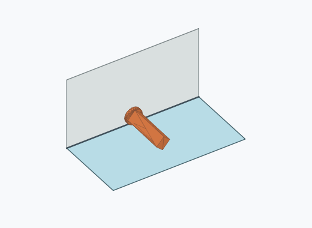 | 7 | 0.07 % | 0.03–0.14 % | 0.07 % |
| Pose 16 | Group 15 |  | 6 | 0.06 % | 0.03–0.13 % | 0.06 % |
| Pose 17 | Group 13 | 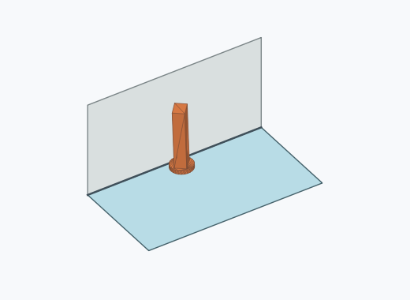 | 5 | 0.05 % | 0.02–0.12 % | 0.05 % |
| Pose 18 | Group 7 |  | 4 | 0.04 % | 0.02–0.10 % | 0.04 % |
| Pose 19 | Group 16 |  | 4 | 0.04 % | 0.02–0.10 % | 0.04 % |
| Pose 20 | Group 17 | 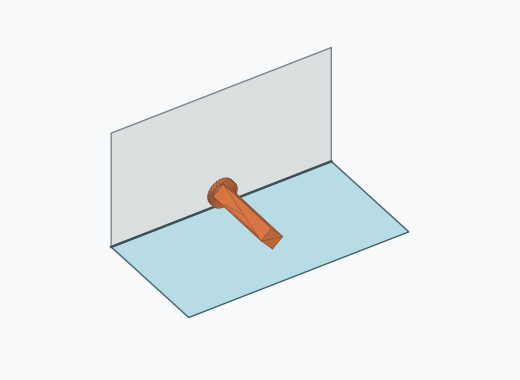 | 3 | 0.03 % | 0.01–0.09 % | 0.03 % |
| Pose 21 | Group 9 | 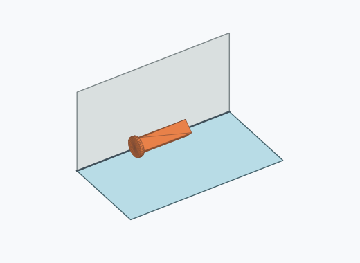 | 3 | 0.03 % | 0.01–0.09 % | 0.03 % |
| Pose 22 | Group 13 |  | 3 | 0.03 % | 0.01–0.09 % | 0.03 % |
| Pose 23 | Group 18 | 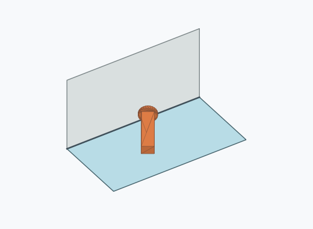 | 2 | 0.02 % | 0.01–0.07 % | 0.02 % |
| Pose 24 | Group 19 |  | 2 | 0.02 % | 0.01–0.07 % | 0.02 % |
| Pose 25 | Group 20 | 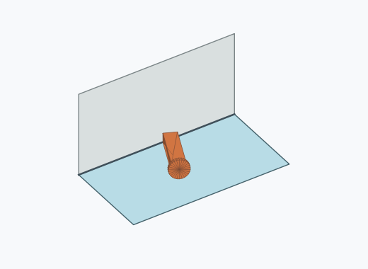 | 2 | 0.02 % | 0.01–0.07 % | 0.02 % |
| Pose 26 | Group 6 | 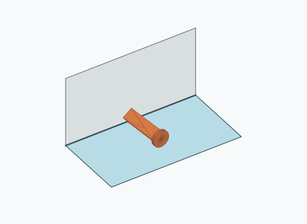 | 1 | 0.01 % | 0.00–0.06 % | 0.01 % |
| Pose 27 | Group 21 |  | 1 | 0.01 % | 0.00–0.06 % | 0.01 % |
| Pose 28 | Group 22 |  | 1 | 0.01 % | 0.00–0.06 % | 0.01 % |
| Pose 29 | Group 11 | 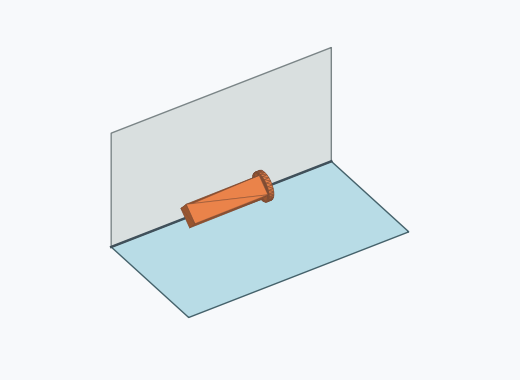 | 1 | 0.01 % | 0.00–0.06 % | 0.01 % |

[Pose catalogue JSON](poses.json) · [Pose catalogue YAML](poses.yaml) · [Frequencies](frequencies.csv) · [Trial records](trials.csv)

Pose orientations use `xyzw` quaternions from the workpiece frame to the chute frame. Recognition uses the recorded symmetry, a 5° tolerance, and a 1° ambiguity margin. The pose registry reserves previously observed IDs for later recognition.

### Historical run files

- [Configuration](config.json)
- [Manifest](manifest.json)
- [Earlier 1,000-drop comparisons](simulations/README.md)
