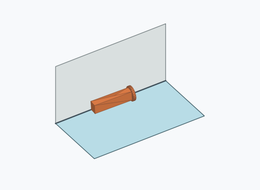
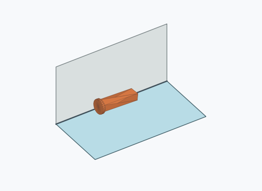
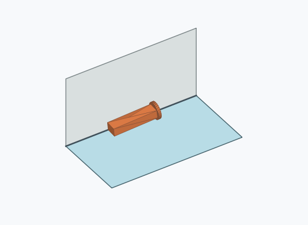
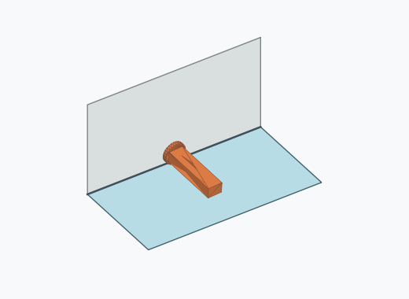
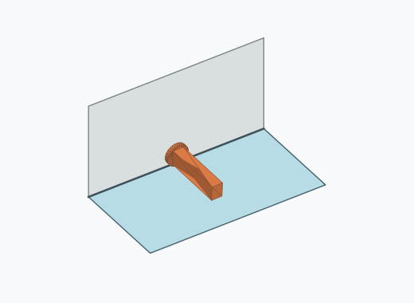
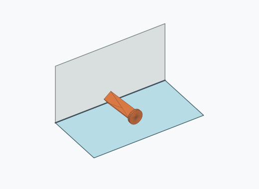

# Rl1a: grouped observed poses

10,000 completed drops; 9,830 settled. 30 assessed source poses; 7 groups meet the 1% cutoff.

Grouping uses 0.5 mm equivalent lift and a 60° maximum diameter. All members receive the same disturbance protocol.

| Representative | Image | Members | Combined count | Frequency | Retention AUC |
| --- | --- | --- | ---: | ---: | ---: |
| Rl1a_0006 |  | Rl1a_0006 | 2462 | 24.62% | 1.0000 |
| Rl1a_0012 |  | Rl1a_0012 | 2234 | 22.34% | 1.0000 |
| Rl1a_0007 |  | Rl1a_0007 | 2221 | 22.21% | 1.0000 |
| Rl1a_0011 |  | Rl1a_0011 | 2156 | 21.56% | 1.0000 |
| Rl1a_0005 |  | Rl1a_0005 | 259 | 2.59% | 0.9844 |
| Rl1a_0001 |  | Rl1a_0001 | 167 | 1.67% | 0.9115 |
| Rl1a_0013 |  | Rl1a_0013, Rl1a_0014, Rl1a_0015 | 150 | 1.50% | 0.8438 |

[All original observations and member images](original_observations.json), [memberships](membership.csv), [barrier evidence](grouping_geometry.json), [member stability curves](group_stability.csv), [individual disturbance curves](stability.csv), [validation](validation.json).

Frequencies retain the original completed-drop denominator. Stability scores describe the configured virtual chute.
