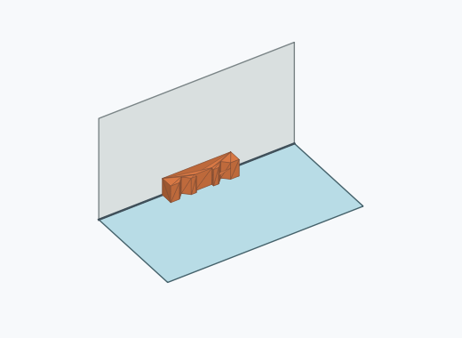
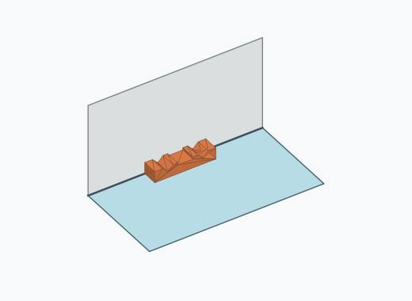
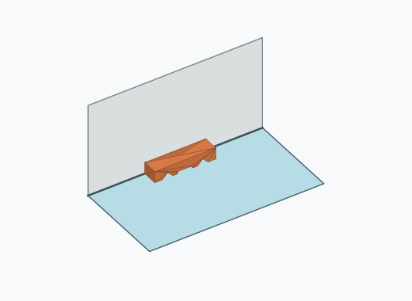
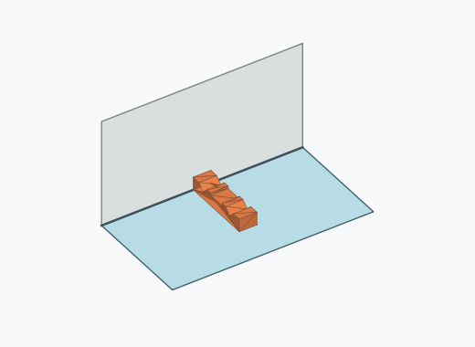

# Rl2i: grouped observed poses

10,000 completed drops; 9,980 settled. 9 assessed source poses; 6 groups meet the 1% cutoff.

Grouping uses 0.5 mm equivalent lift and a 60° maximum diameter. All members receive the same disturbance protocol.

| Representative | Image | Members | Combined count | Frequency | Retention AUC |
| --- | --- | --- | ---: | ---: | ---: |
| Rl2i_0007 |  | Rl2i_0007 | 2718 | 27.18% | 1.0000 |
| Rl2i_0001 |  | Rl2i_0001 | 2450 | 24.50% | 1.0000 |
| Rl2i_0006 |  | Rl2i_0006 | 2265 | 22.65% | 1.0000 |
| Rl2i_0002 |  | Rl2i_0002 | 2157 | 21.57% | 1.0000 |
| Rl2i_0005 |  | Rl2i_0005 | 171 | 1.71% | 0.9844 |
| Rl2i_0008 |  | Rl2i_0008 | 162 | 1.62% | 1.0000 |

[All original observations and member images](original_observations.json), [memberships](membership.csv), [barrier evidence](grouping_geometry.json), [member stability curves](group_stability.csv), [individual disturbance curves](stability.csv), [validation](validation.json).

Frequencies retain the original completed-drop denominator. Stability scores describe the configured virtual chute.
