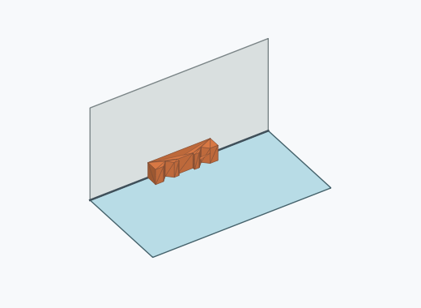
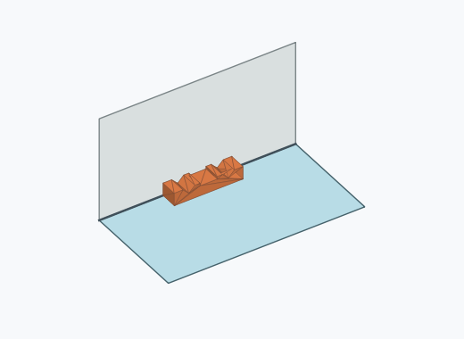
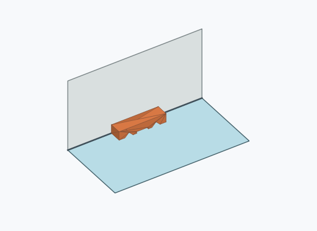
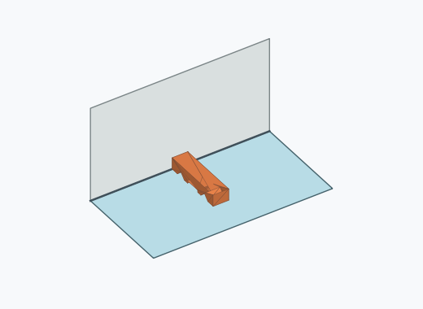
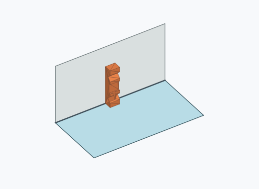
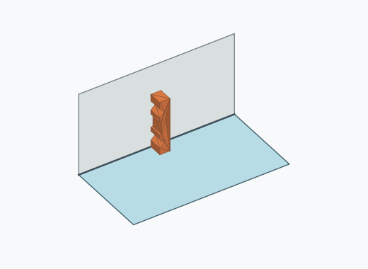

# Rl2i

[Workpiece index](../README.md#workpieces)

## Historical pose catalogue

Group numbers rank the saved pose basins by their combined incidence within each observation phase. Pose 0 is the most frequent individual pose in its observation phase. The membership CSV links the displayed numbers to the saved pose IDs. Groups below 1% remain visible.

[Group membership CSV](group_memberships.csv) · [Grouping method](../README.md#catalogue-grouping)

### Transport poses

9,980 settled outcomes across 10,000 historical drops on a 500 mm chute. Incidence uses all completed drops as the denominator.

Outcome counts: settled: 9,980, unsettled: 20.

| Pose | Group | Image | Count | Incidence | 95% interval | Share of settled outcomes |
| --- | --- | --- | ---: | ---: | ---: | ---: |
| Pose 0 | Group 0 |  | 2718 | 27.18 % | 26.32–28.06 % | 27.23 % |
| Pose 1 | Group 1 |  | 2450 | 24.50 % | 23.67–25.35 % | 24.55 % |
| Pose 2 | Group 2 |  | 2265 | 22.65 % | 21.84–23.48 % | 22.70 % |
| Pose 3 | Group 3 |  | 2157 | 21.57 % | 20.77–22.39 % | 21.61 % |
| Pose 4 | Group 4 |  | 171 | 1.71 % | 1.47–1.98 % | 1.71 % |
| Pose 5 | Group 5 |  | 162 | 1.62 % | 1.39–1.89 % | 1.62 % |
| Pose 6 | Group 6 |  | 32 | 0.32 % | 0.23–0.45 % | 0.32 % |
| Pose 7 | Group 7 |  | 19 | 0.19 % | 0.12–0.30 % | 0.19 % |
| Pose 8 | Group 8 |  | 6 | 0.06 % | 0.03–0.13 % | 0.06 % |

[Pose catalogue JSON](poses.json) · [Pose catalogue YAML](poses.yaml) · [Frequencies](frequencies.csv) · [Trial records](trials.csv)

Pose orientations use `xyzw` quaternions from the workpiece frame to the chute frame. Recognition uses the recorded symmetry, a 5° tolerance, and a 1° ambiguity margin. The pose registry reserves previously observed IDs for later recognition.

### Historical run files

- [Configuration](config.json)
- [Manifest](manifest.json)

<!-- remaining-workpieces-20261110_10000:start -->
## Additional 10,000-drop runs

10,000 stationary and 10,000 moving-belt drops with the archived reference settings.

[Results and validation](simulations/20261110_10000/README.md).
<!-- remaining-workpieces-20261110_10000:end -->
