# Rl3a

[Workpiece index](../README.md#workpieces)

## Historical pose catalogue

Group numbers rank the saved pose basins by their combined incidence within each observation phase. Pose 0 is the most frequent individual pose in its observation phase. The membership CSV links the displayed numbers to the saved pose IDs. Groups below 1% remain visible.

[Group membership CSV](group_memberships.csv) · [Grouping method](../README.md#catalogue-grouping)

### Transport poses

9,883 settled outcomes across 10,000 historical drops on a 500 mm chute. Incidence uses all completed drops as the denominator.

Outcome counts: settled: 9,883, unsettled: 117.

| Pose | Group | Image | Count | Incidence | 95% interval | Share of settled outcomes |
| --- | --- | --- | ---: | ---: | ---: | ---: |
| Pose 0 | Group 0 | 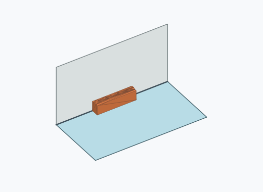 | 2507 | 25.07 % | 24.23–25.93 % | 25.37 % |
| Pose 1 | Group 1 | 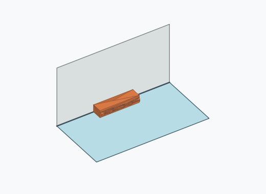 | 2350 | 23.50 % | 22.68–24.34 % | 23.78 % |
| Pose 2 | Group 2 | 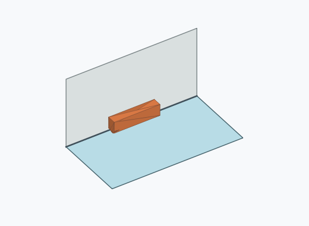 | 2172 | 21.72 % | 20.92–22.54 % | 21.98 % |
| Pose 3 | Group 3 | 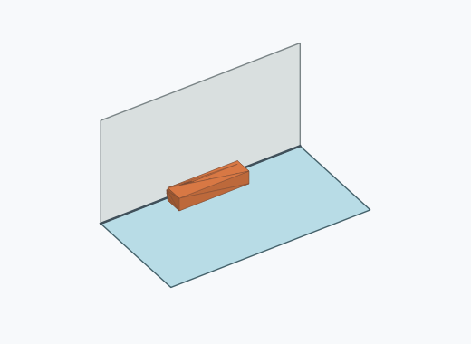 | 1742 | 17.42 % | 16.69–18.18 % | 17.63 % |
| Pose 4 | Group 5 | 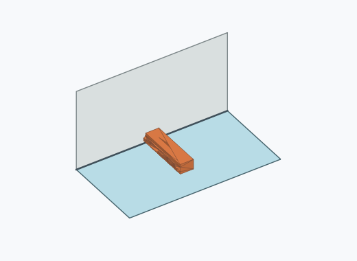 | 227 | 2.27 % | 2.00–2.58 % | 2.30 % |
| Pose 5 | Group 6 |  | 197 | 1.97 % | 1.72–2.26 % | 1.99 % |
| Pose 6 | Group 7 | 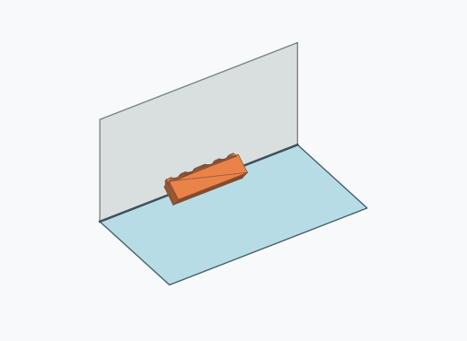 | 154 | 1.54 % | 1.32–1.80 % | 1.56 % |
| Pose 7 | Group 4 | 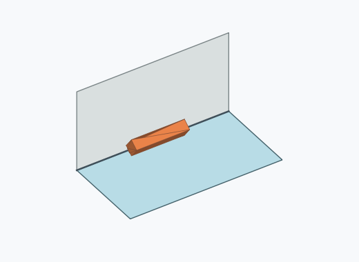 | 151 | 1.51 % | 1.29–1.77 % | 1.53 % |
| Pose 8 | Group 8 | 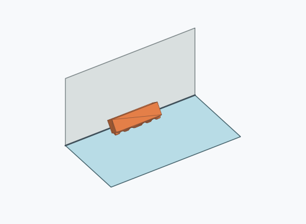 | 113 | 1.13 % | 0.94–1.36 % | 1.14 % |
| Pose 9 | Group 4 |  | 109 | 1.09 % | 0.90–1.31 % | 1.10 % |
| Pose 10 | Group 10 | 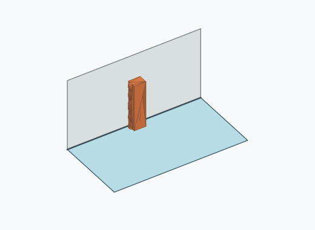 | 54 | 0.54 % | 0.41–0.70 % | 0.55 % |
| Pose 11 | Group 9 | 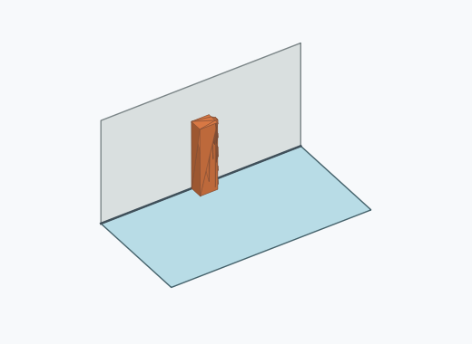 | 46 | 0.46 % | 0.35–0.61 % | 0.47 % |
| Pose 12 | Group 9 | 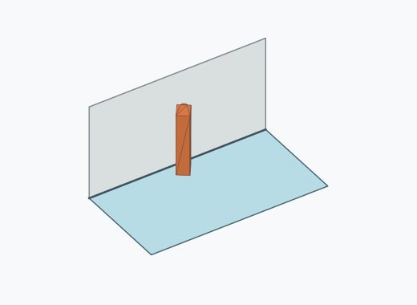 | 28 | 0.28 % | 0.19–0.40 % | 0.28 % |
| Pose 13 | Group 11 | 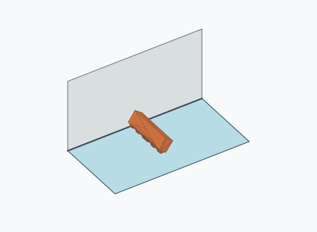 | 24 | 0.24 % | 0.16–0.36 % | 0.24 % |
| Pose 14 | Group 3 | 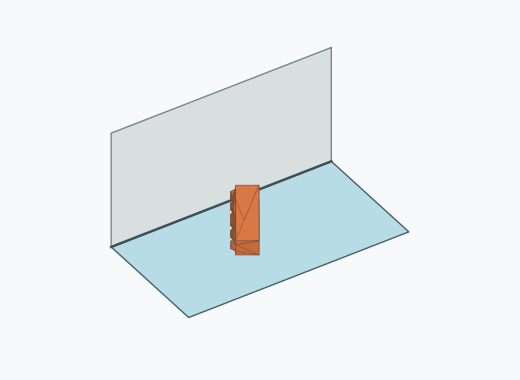 | 4 | 0.04 % | 0.02–0.10 % | 0.04 % |
| Pose 15 | Group 5 |  | 2 | 0.02 % | 0.01–0.07 % | 0.02 % |
| Pose 16 | Group 12 | 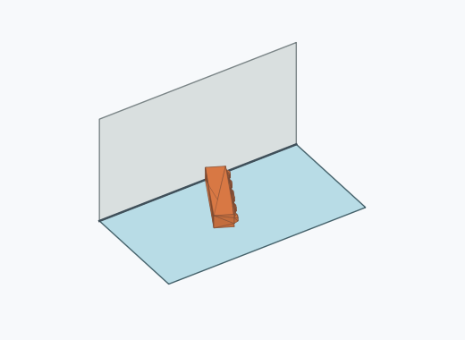 | 2 | 0.02 % | 0.01–0.07 % | 0.02 % |
| Pose 17 | Group 13 |  | 1 | 0.01 % | 0.00–0.06 % | 0.01 % |

[Pose catalogue JSON](poses.json) · [Pose catalogue YAML](poses.yaml) · [Frequencies](frequencies.csv) · [Trial records](trials.csv)

Pose orientations use `xyzw` quaternions from the workpiece frame to the chute frame. Recognition uses the recorded symmetry, a 5° tolerance, and a 1° ambiguity margin. The pose registry reserves previously observed IDs for later recognition.

### Historical run files

- [Configuration](config.json)
- [Manifest](manifest.json)

<!-- remaining-workpieces-20261110_10000:start -->
## Additional 10,000-drop runs

10,000 stationary and 10,000 moving-belt drops with the archived reference settings.

[Results and validation](simulations/20261110_10000/README.md).
<!-- remaining-workpieces-20261110_10000:end -->
