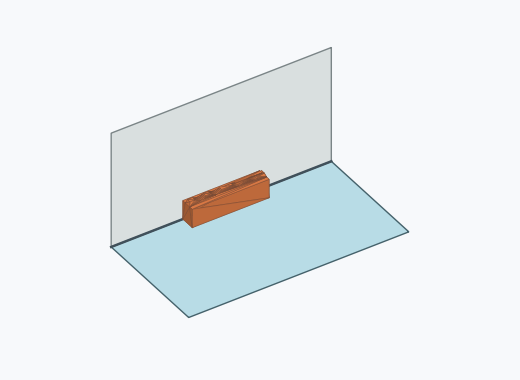
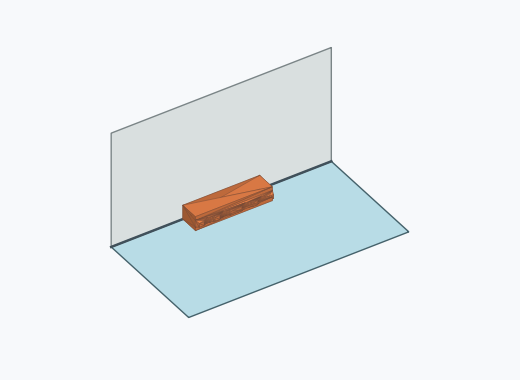
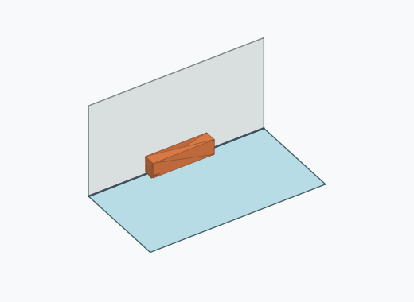
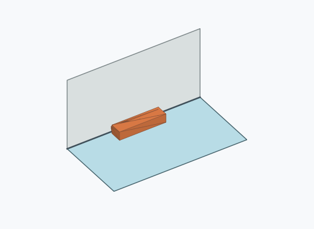
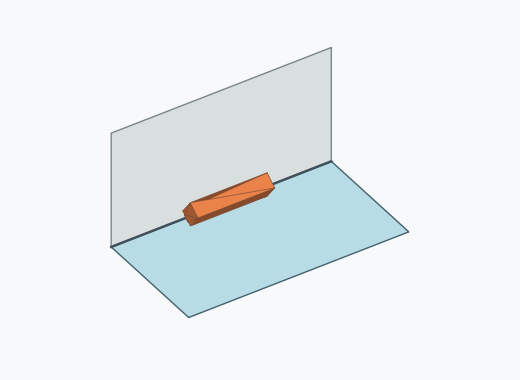
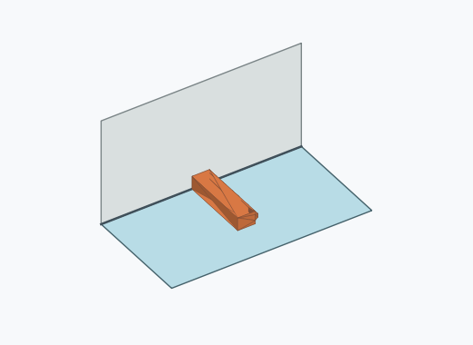
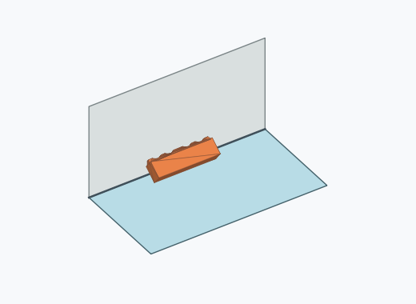
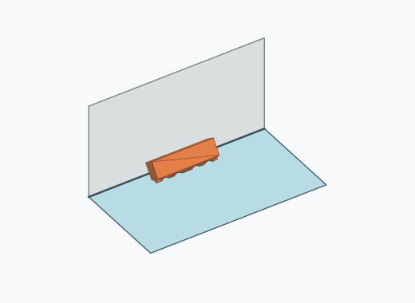

# Rl3a: grouped observed poses

10,000 completed drops; 9,883 settled. 18 assessed source poses; 9 groups meet the 1% cutoff.

Grouping uses 0.5 mm equivalent lift and a 60° maximum diameter. All members receive the same disturbance protocol.

| Representative | Image | Members | Combined count | Frequency | Retention AUC |
| --- | --- | --- | ---: | ---: | ---: |
| Rl3a_0013 |  | Rl3a_0013 | 2507 | 25.07% | 1.0000 |
| Rl3a_0011 |  | Rl3a_0011 | 2350 | 23.50% | 1.0000 |
| Rl3a_0009 |  | Rl3a_0009 | 2172 | 21.72% | 1.0000 |
| Rl3a_0002 |  | Rl3a_0002, Rl3a_0015 | 1746 | 17.46% | 1.0000 |
| Rl3a_0006 |  | Rl3a_0004, Rl3a_0006 | 260 | 2.60% | 1.0000 |
| Rl3a_0016 |  | Rl3a_0016, Rl3a_0017 | 229 | 2.29% | 0.9740 |
| Rl3a_0007 |  | Rl3a_0007 | 197 | 1.97% | 0.9167 |
| Rl3a_0014 |  | Rl3a_0014 | 154 | 1.54% | 1.0000 |
| Rl3a_0010 |  | Rl3a_0010 | 113 | 1.13% | 1.0000 |

[All original observations and member images](original_observations.json), [memberships](membership.csv), [barrier evidence](grouping_geometry.json), [member stability curves](group_stability.csv), [individual disturbance curves](stability.csv), [validation](validation.json).

Frequencies retain the original completed-drop denominator. Stability scores describe the configured virtual chute.
