# Rl4i

[Workpiece index](../README.md#workpieces)

## Historical pose catalogue

Group numbers rank the saved pose basins by their combined incidence within each observation phase. Pose 0 is the most frequent individual pose in its observation phase. The membership CSV links the displayed numbers to the saved pose IDs. Groups below 1% remain visible.

[Group membership CSV](group_memberships.csv) · [Grouping method](../README.md#catalogue-grouping)

### Transport poses

9,992 settled outcomes across 10,000 historical drops on a 500 mm chute. Incidence uses all completed drops as the denominator.

Outcome counts: settled: 9,992, unsettled: 8.

| Pose | Group | Image | Count | Incidence | 95% interval | Share of settled outcomes |
| --- | --- | --- | ---: | ---: | ---: | ---: |
| Pose 0 | Group 0 | 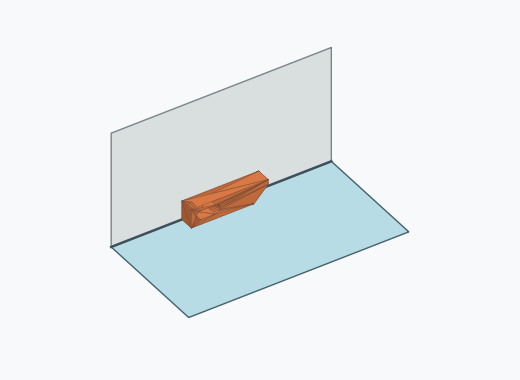 | 1476 | 14.76 % | 14.08–15.47 % | 14.77 % |
| Pose 1 | Group 1 | 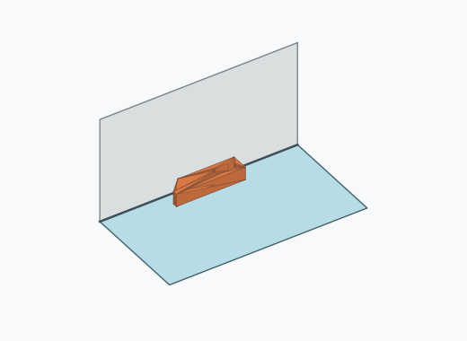 | 1424 | 14.24 % | 13.57–14.94 % | 14.25 % |
| Pose 2 | Group 2 |  | 1404 | 14.04 % | 13.37–14.73 % | 14.05 % |
| Pose 3 | Group 3 | 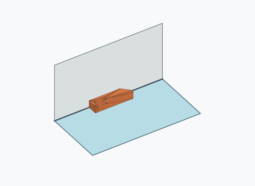 | 1362 | 13.62 % | 12.96–14.31 % | 13.63 % |
| Pose 4 | Group 4 | 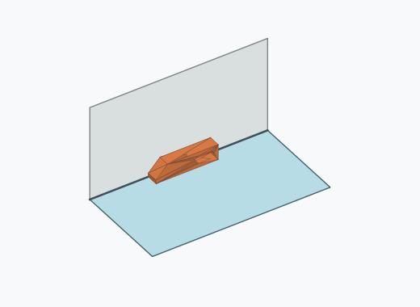 | 1040 | 10.40 % | 9.82–11.01 % | 10.41 % |
| Pose 5 | Group 5 | 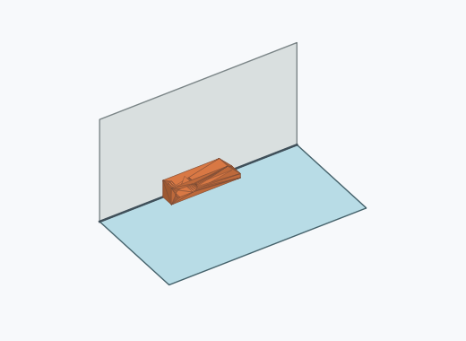 | 1037 | 10.37 % | 9.79–10.98 % | 10.38 % |
| Pose 6 | Group 6 |  | 1027 | 10.27 % | 9.69–10.88 % | 10.28 % |
| Pose 7 | Group 7 | 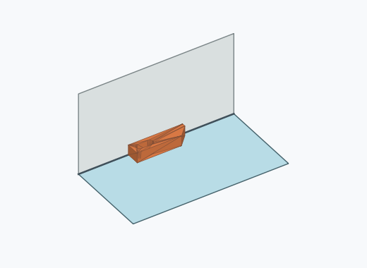 | 981 | 9.81 % | 9.24–10.41 % | 9.82 % |
| Pose 8 | Group 8 | 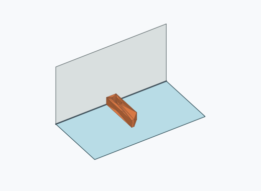 | 87 | 0.87 % | 0.71–1.07 % | 0.87 % |
| Pose 9 | Group 9 | 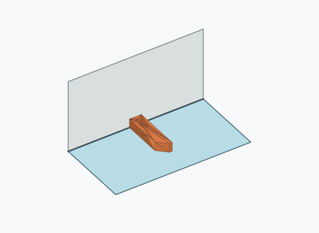 | 55 | 0.55 % | 0.42–0.72 % | 0.55 % |
| Pose 10 | Group 10 | 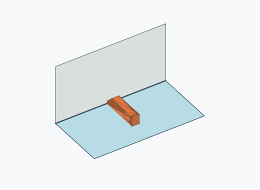 | 27 | 0.27 % | 0.19–0.39 % | 0.27 % |
| Pose 11 | Group 11 | 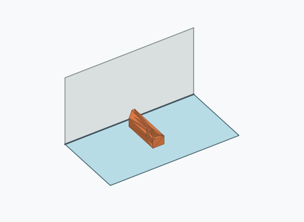 | 19 | 0.19 % | 0.12–0.30 % | 0.19 % |
| Pose 12 | Group 12 |  | 17 | 0.17 % | 0.11–0.27 % | 0.17 % |
| Pose 13 | Group 13 | 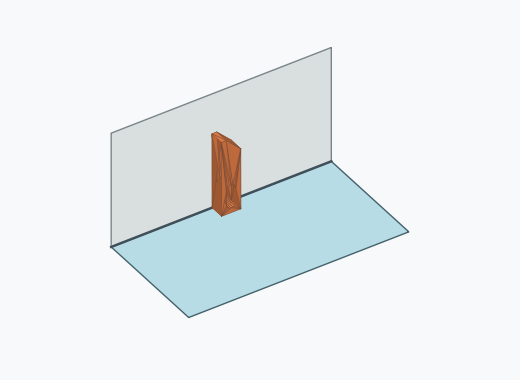 | 12 | 0.12 % | 0.07–0.21 % | 0.12 % |
| Pose 14 | Group 14 | 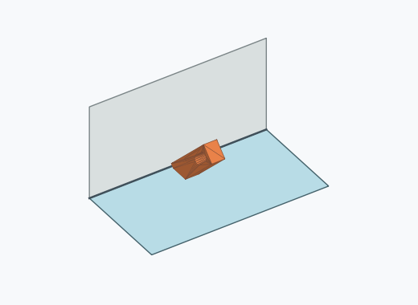 | 10 | 0.10 % | 0.05–0.18 % | 0.10 % |
| Pose 15 | Group 15 | 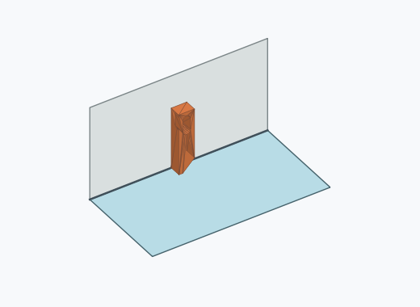 | 7 | 0.07 % | 0.03–0.14 % | 0.07 % |
| Pose 16 | Group 16 | 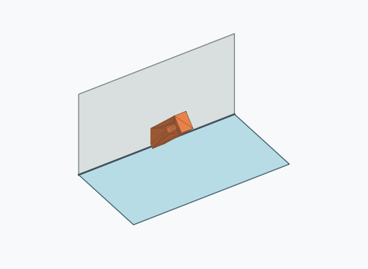 | 3 | 0.03 % | 0.01–0.09 % | 0.03 % |
| Pose 17 | Group 17 | 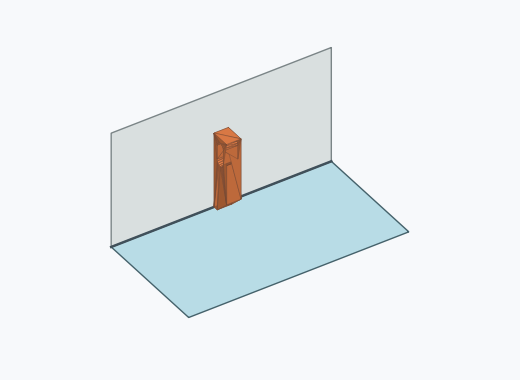 | 3 | 0.03 % | 0.01–0.09 % | 0.03 % |
| Pose 18 | Group 18 | 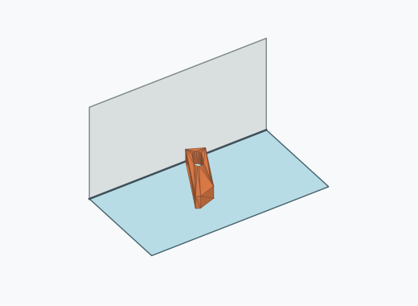 | 1 | 0.01 % | 0.00–0.06 % | 0.01 % |

[Pose catalogue JSON](poses.json) · [Pose catalogue YAML](poses.yaml) · [Frequencies](frequencies.csv) · [Trial records](trials.csv)

Pose orientations use `xyzw` quaternions from the workpiece frame to the chute frame. Recognition uses the recorded symmetry, a 5° tolerance, and a 1° ambiguity margin. The pose registry reserves previously observed IDs for later recognition.

### Historical run files

- [Configuration](config.json)
- [Manifest](manifest.json)

<!-- remaining-workpieces-20261110_10000:start -->
## Additional 10,000-drop runs

10,000 stationary and 10,000 moving-belt drops with the archived reference settings.

[Results and validation](simulations/20261110_10000/README.md).
<!-- remaining-workpieces-20261110_10000:end -->
