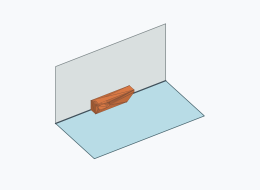
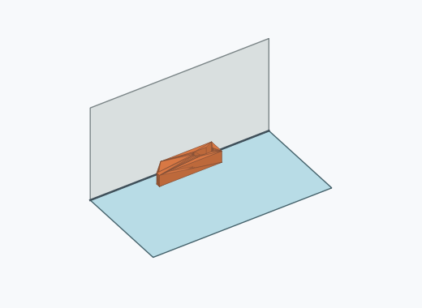
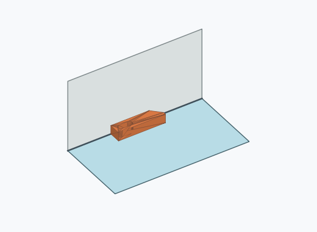
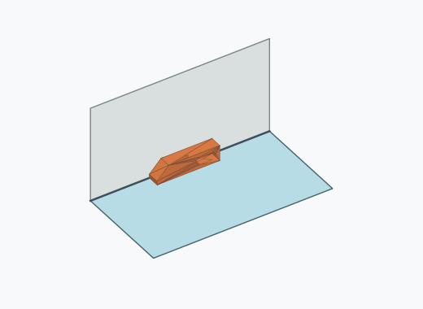
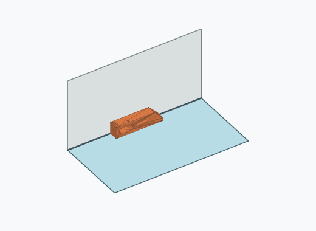
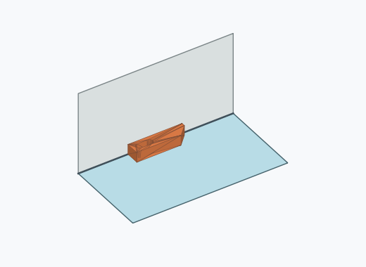

# Rl4i: grouped observed poses

10,000 completed drops; 9,992 settled. 19 assessed source poses; 8 groups meet the 1% cutoff.

Grouping uses 0.5 mm equivalent lift and a 60° maximum diameter. All members receive the same disturbance protocol.

| Representative | Image | Members | Combined count | Frequency | Retention AUC |
| --- | --- | --- | ---: | ---: | ---: |
| Rl4i_0004 |  | Rl4i_0004 | 1476 | 14.76% | 1.0000 |
| Rl4i_0001 |  | Rl4i_0001 | 1424 | 14.24% | 1.0000 |
| Rl4i_0005 |  | Rl4i_0005 | 1404 | 14.04% | 1.0000 |
| Rl4i_0002 |  | Rl4i_0002 | 1362 | 13.62% | 1.0000 |
| Rl4i_0012 |  | Rl4i_0012 | 1040 | 10.40% | 1.0000 |
| Rl4i_0014 |  | Rl4i_0014 | 1037 | 10.37% | 1.0000 |
| Rl4i_0008 |  | Rl4i_0008 | 1027 | 10.27% | 1.0000 |
| Rl4i_0007 |  | Rl4i_0007 | 981 | 9.81% | 1.0000 |

[All original observations and member images](original_observations.json), [memberships](membership.csv), [barrier evidence](grouping_geometry.json), [member stability curves](group_stability.csv), [individual disturbance curves](stability.csv), [validation](validation.json).

Frequencies retain the original completed-drop denominator. Stability scores describe the configured virtual chute.
